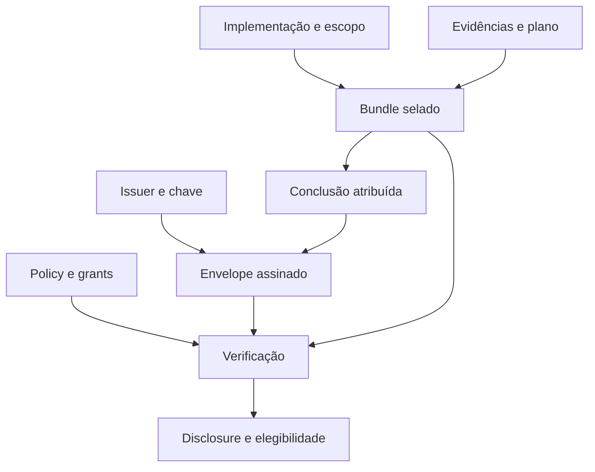

# POSE — frente 2: autoridade, identidade, evidências e atestações

**Data:** 2026-10-11, America/Recife; execuções em 2026-10-12 UTC.

**Baseline:** `deca220e14d402039d682952663e9a109a719da6`, após o merge do PR #147.

**Escopo:** diagnóstico da cadeia de confiança; não altera código, políticas ou decisões de adoção.

**Companions:** [evidências e backlog estruturados](../results/2026-10-11-pose-front-02-trust-chain.json) · [índice das frentes](2026-10-11-pose-analysis-index.md) · [baseline da frente 1](2026-10-11-pose-front-01-current-state.md).

## 1. Parecer executivo

A fundação criptográfica e semântica do POSE tem decisões acertadas: assinatura pinada por chave, claim vinculado ao bundle, principal e execução separados, grant específico para afirmar um principal humano, contratos selados, confirmação vinculada à conclusão e histórico preservado. A análise atual não recomenda substituir essa arquitetura.

O problema central encontrado é a **propagação incompleta das garantias entre gravação, leitura, apresentação e consumo por gates**. Validar uma assinatura ao receber um registro não basta se a leitura posterior confiar em um rótulo de assurance. Recusar uma aprovação inválida no CLI nativo não basta se o import assinado e o MCP a persistirem. Apresentar `verified` exige que a superfície esteja consumindo o resultado da verificação criptográfica, não apenas campos que parecem coerentes.

Quatro achados foram reproduzidos no binário publicado 7.4.1, em fixtures descartáveis:

1. Um preview MCP encontrou 18 blockers em uma aprovação incompleta; o apply do envelope assinado a gravou. O import CLI do mesmo envelope também retornou sucesso.
2. A leitura de um journal aceitou uma resposta marcada `verified` sem prova; após uma gravação válida por issuer, a mudança do campo `answer` foi apresentada como `verified`, embora o claim assinasse outra resposta.
3. `require_presence: true` permitiu resposta humana por claim de issuer sem evidência de presença. O contrato R5 da spec de respostas assinadas exige recusa de resposta humana sem presença; a restrição está implementada somente no caminho SSHSIG.
4. `identity_assurance: {"spce": "verified"}` foi aceita, e a projeção de governança declarou a capability efetiva para o escopo inexistente `spce`. A seleção do assurance de specs consulta `spec`, não essa chave.

Há outros quatro deltas confirmados por leitura dirigida, cuja extensão necessita reproduções adicionais: disclosure sem comprovação criptográfica própria; perdas silenciosas no inventário de reviews; reuso sem validar integralmente a autoridade da fonte; e semântica temporal dos claims.

Isso **não demonstra um bypass completo de closeout ou um comprometimento remoto**. A verificação semântica de bundle possui proteções adicionais. As reproduções de alteração de journal pressupõem acesso de escrita aos arquivos do fixture: demonstram insuficiência da validação de persistência, não obtenção desse acesso. A prioridade é tornar a cadeia verificável em cada consumo relevante antes de ampliar a revisão delegada autônoma.

## 2. Método e fidelidade da baseline

Foram inspecionados os tipos, leitores, writers e verificadores de bundles, attestations, envelopes, attribution, assurance, claims de reviews e ações, chaves nativas, SSHSIG, ledger legado, reuso e retenção de reviews concluídas. Também foram lidos os testes dirigidos e as specs que definem os contratos discutidos. O código determina o comportamento; specs e documentação determinam compromissos a confrontar com ele.

O merge da frente 1 acrescentou somente documentos. O código executável da baseline permanece equivalente ao da tag 7.4.1. Foi usado o mesmo binário da frente 1, SHA-256 `9ae6e0855c8b82599cab1d9999ae3a20644e091a5e0490b2f85d593294104d66`.

A [CI da baseline](https://github.com/oseiaspereira88/pose/actions/runs/38193224519) foi consultada com conclusão `success`. O workflow executa `go -C pose-mcp test ./... -count=1`. **A suíte Go não foi reexecutada localmente**, porque não há toolchain disponível neste ambiente. As reproduções locais usam o binário e RPC MCP via stdio; não dependem de fornecedores de IA, rede, contas ou chaves reais.

As chaves Ed25519 dos probes foram geradas em memória; políticas, journals e envelopes foram escritos apenas em diretórios descartáveis. Nenhum registro real do projeto foi adulterado. O JSON companion distingue `runtime_reproduced`, `source_confirmed` e propostas, com fontes imutáveis e critérios de aceite. Propostas de severidade/prioridade são julgamentos desta análise, não decisões já adotadas pelo mantenedor.

## 3. O que cada garantia significa

| Dimensão | Pergunta respondida | Evidência adequada | Limite |
|---|---|---|---|
| Identidade declarada | Que nome foi registrado? | String de principal e seu prefixo | Qualquer caller pode escrever um nome |
| Integridade do registro | Os bytes correspondem ao objeto identificado? | Digest recalculado, parsing estrito | Hash sem assinatura não autentica autoria |
| Assinatura da attestation | Que chave assinou estes bytes? | Envelope Ed25519 e pin confiável | Assinar não comprova conteúdo correto |
| Autoridade do emissor | O emissor pode fazer esta afirmação? | Grant/pin pertinente na policy | Um grant de assinatura não é grant humano |
| Identidade humana afirmada | Um issuer autorizado afirmou esta pessoa? | Claim, principal humano e human-authority grant | A verdade dessa identificação depende do issuer |
| Presença no dispositivo | A assinatura afirmou toque/presença? | Flags verificadas de chave `ed25519-sk` | Presença não prova leitura ou concordância com cada conclusão |
| Separação de execução | Implementação e review têm runs distintos? | IDs vinculados em claim confiável | IDs supplied pelo caller não são observação independente do runner |
| Separação de ator | Principais distintos atenderam à policy? | Claim válido e comparação dos principais | Não demonstra independência cognitiva |
| Atribuição de papéis | Quem preparou, concluiu, confirmou e aplicou? | Attribution explícita e confirmação vinculada | Um envelope não transforma todos os papéis declarados em identidades verificadas |
| Evidência pertinente | O critério cita evidência do bundle, da classe e componente adequados? | Verificador de evidência e contrato do critério | Referência válida não prova suficiência do teste |
| Julgamento | O reviewer examinou e concluiu o critério? | Conclusão atribuída e rationale pertinente | Formato não demonstra profundidade intelectual |
| Elegibilidade de fechamento | A entrega satisfaz os gates do escopo? | Verificação de review, lifecycle, trace e domínio | Não equivale a certificação de qualidade em produção |

Essas dimensões devem continuar independentes no contrato de saída. Um resultado pode ter assinatura válida, identidade declarada e aprovação semanticamente inválida. Um registro histórico pode estar preservado por ledger sem provar retrospectivamente que houve revisão humana.

## 4. Cadeia de confiança implementada

O fluxo preserva duas separações fundamentais. O bundle fixa o assunto e parte do contrato; a policy mantém decisões de confiança que precisam permanecer vivas. A conclusão não surge automaticamente da existência do bundle: a preparação responde critérios mecânicos e deixa judgment pendente.

### 4.1. Selado e vivo

`ReviewBundleGates` sela identity assurance, aceitação de riscos/reservations e permissão de reuso; `GoverningContracts` registra contratos conhecidos ao selar. A ausência histórica de assurance é lida como declared, evitando inventar prova antiga. Mudança de policy não deve reescrever o significado do julgamento selado.

Assinatura requerida, pins e grants são consultados na confiança atual. `validateBundleAttestationWith` revalida assinatura quando a policy exige ou quando há envelope. Esse comportamento permite revogar confiança; é diferente de reinterpretar um julgamento histórico. A release precisa documentar o que permanece selado e o que é revogável.

### 4.2. Criptografia e autoridade

`VerifyReviewAttestationEnvelope` verifica schema/algoritmo, subject, chave, pin, assinatura e binding ao bundle. `verifiedAuthorityBlockers` verifica principal, issuer, project, audience, role/grant, execução e independência exigida. O grant humano é vinculado à chave por digest, não apenas ao nome do issuer.

`SignReviewAttestation` nativo monta o claim a partir dos parâmetros fornecidos pelo caller. A chave fica fora do projeto; o carregamento recusa permissões abertas, symlink, hard link adicional e arquivo não regular. São proteções úteis de custódia e publicação acidental. **Não isolam automaticamente o agente implementador de uma chave acessível à mesma conta do sistema operacional**, nem observam a existência real dos runs informados.

Para fechar o gap do agente secundário, a frente 3 deverá ligar esses campos a execução observada e a um run record. Não basta colocar valores diferentes em `--review-execution` e `--implementation-execution`.

### 4.3. Atribuição e confirmação

`ReviewAttribution` separa quatro papéis e não os infere de `Reviewer`. `ReviewConfirmationDigest` vincula bundle, decisão, critérios, tools e findings. `DescribeReviewAttribution` só atribui confirmação humana verificada quando o claim validado corresponde ao principal confirmador e ao role humano.

Suplementos não podem acrescentar confirmação retroativa. Isso deve ser preservado: esclarecer que um agente produziu uma review antiga não equivale a alguém adotá-la agora. “Autorizou a operação” e “adotou as conclusões” permanecem atos distintos.

### 4.4. Evidência e julgamento

O verificador exige que um `passed` cite evidência selada; quando o critério declara classes, checa classe e compatibilidade de componente. Finding deve existir na própria attestation; aceitação de risco precisa atender às severidades seladas, owner, rationale e review date. Judgment governado exige conclusão; `not-applicable` exige rationale e possui proteções contra dispensa degenerada.

A proveniência diferencia observed, carried-forward e unknown, sem exigir reexecução ritual de todo o histórico. Esses mecanismos são valiosos. A próxima release deve corrigir os pontos de consumo, preservando a proporcionalidade e o reuso que continuam justificados.

## 5. Adoção e histórico da instância auditada

| Observação | Quantidade / configuração | Leitura correta |
|---|---|---|
| Bundles retidos | 1.416 | Inventário, não quantidade de entregas únicas |
| Bundles com assurance declared explícito | 921 | Declaração selada, não identidade autenticada |
| Bundles anteriores ao campo | 495 | Compatibilidade histórica |
| Attestations retidas | 1.402 | Incluem tentativas e supersessions |
| Attestations com envelope | 0 | O checkout versionado não demonstra adoção geral de assinatura |
| Attribution diferenciada | 46 | Papéis explícitos; verificar sua assurance separadamente |
| Attribution ausente | 1.356 | Legado sem papéis discriminados |
| Policy de review | Sem identity_assurance/pins/grants/require_signed explícitos | Suporte à confiança forte não é adoção dela nesta instância |

Não é uma recomendação para converter todas as 1.402 attestations ou adotar verified universalmente. A decisão de adoção depende do escopo e do threat model. Os novos caminhos devem permitir POSE standalone e runners externos pelo mesmo contrato, preservando decisões já aceitas de autonomia e escalonamento humano por exceção.

O ledger legado autentica o inventário e os digests aceitos na adoção de signed-attestations; não autentica retrospectivamente a identidade intelectual de cada review. O writer do ledger revalida policy e conjunto de entradas antes de escrever e usa criação exclusiva. A leitura exige assinatura, pin e projeto. O ledger de runs delegados continua sendo outro trabalho, tratado na frente 3.

## 6. Achados e correções recomendadas

### T2-01 — Leitura de respostas não estabelece a prova que declara

**Prioridade proposta: P0 de integridade. Estado: reproduzido.**

`LoadActionRequest` valida abertura, digest da solicitação e sequência do journal. `deriveActionView` lê `event.Assurance` e o propaga para `view.Assurance`; não revalida a assinatura/claim nem seu binding à resposta. A verificação SSH existente é chamada no rendering textual de `action show`, sem transformar o estado derivado. O JSON, a agregação de obligations e os gates que leem as views não passam por esse rendering.

Reproduções: (a) evento `answered` sem signature/claim, marcado verified, retornou `answered`, `satisfied`, `verified`, sem limitations; (b) uma resposta válida por issuer foi gravada e apenas `event.answer` mudou de adopt para decline; `action show --json` retornou decline com verified, enquanto `event.claim.answer` permaneceu adopt.

O cenário pressupõe edição dos arquivos. A propriedade violada é a promessa de verificar o que o consumidor lê. Um caller pode observar estado errado mesmo quando o writer original cumpriu o contrato. Não foi executada uma transição real de closeout para afirmar seu bypass.

**Recomendação:** introduzir um resultado de verificação do evento persistido, consumido por view, obligations e gates. Checar binding completo, prova e estado de conhecimento; não promover rótulo armazenado a fato. Uma resposta cuja prova falhou deve permanecer auditável e não satisfazer o efeito governado. Definir política histórica: provar autenticidade de evento antigo não exige reautorizar seu role com a policy atual; revogação deve ser explícita.

**Aceite:** modificar answer, actor, request digest, reason ou proof após uma gravação válida deve produzir prova inválida/incomplete e impedir satisfação; `show`, JSON, MCP, Attention e gate devem concordar. Registros legados declared continuam legados, sem upgrade automático nem bloqueio global retroativo.

### T2-02 — Preflight não é uniforme nos writers de attestations

**Prioridade proposta: P1. Estado: reproduzido.**

CLI normal/nativo e auto-attest chamam `PreflightReviewAttestation`; `RecordReviewAttestationEnvelope` verifica envelope e grava sem chamar esse preflight. O MCP apply e o CLI `--envelope` usam esse caminho. O preview MCP de draft retorna `verify_blockers`; o apply de envelope não os usa como recusa.

Um bundle com 12 critérios required recebeu aprovação vazia. Preview: 12 critérios e seis tool dispositions ausentes. Apply MCP assinado: `recorded: true`, um arquivo imutável. Import CLI: exit 0. Emissor não confiável e assinatura sobre conteúdo alterado foram recusados nos controles: o problema é semântico, não ausência de verificação criptográfica.

**Recomendação:** fazer o domínio aplicar o mesmo verificador às decisões aprovadoras antes da persistência, após completar identidade e envelope. A mesma operação deve definir o resultado dos writers, sem cópias de regras em CLI/MCP. Decisões negativas continuam registros de auditoria legítimos e não são recusadas simplesmente porque não autorizam closeout.

**Aceite:** CLI normal, nativo, import, MCP e cliente Store recusam a mesma aprovação inválida com zero records; approvals válidas e rejeições conservam seu comportamento. A preview deve distinguir “assinatura válida” de “aprovação aceita”. Reutilizar a intenção da spec `pose-attest-refuses-what-verify-rejects`, sem declarar que o closeout atual aceita o registro inválido.

### T2-03 — Disclosure verified pode depender apenas de coerência dos campos

**Prioridade proposta: P1. Estado: leitura confirmada; reprodução adicional pendente.**

`describeReviewAssurance` usa ausência de blockers de `verifiedAuthorityBlockers` para emitir reviewer identity verified e separation verified. Essa função inspeciona claim e presença de envelope, mas não verifica a assinatura. A assinatura é checada em outro ponto por `validateBundleAttestationWith`.

`VerifyReviewBundle` pode devolver aprovação falsa com blockers criptográficos e, ainda assim, anexar disclosure calculado separadamente. A hipótese dirigida é um envelope adulterado com campos de claim/grant coerentes: o verdict recusa, mas o disclosure pode continuar forte. Não afirmar que uma assinatura inválida autoriza fechamento.

**Recomendação:** produzir e propagar um resultado estruturado de verificação de prova, com `valid`, `invalid`, `unavailable` ou `not-required`, e construir assurance a partir dele. Validar assinatura e claim é separado de validar todos os critérios: uma aprovação semanticamente inválida ainda pode ter identidade verificada, mas assinatura inválida não pode fundamentá-la.

**Aceite:** signature alterada, issuer não confiável ou proof ausente nunca geram identidade/separação/confirmador verified em nenhuma superfície. Disclosure de critério inválido preserva as garantias de identidade que foram efetivamente comprovadas.

### T2-04 — require_presence perde efeito no caminho de issuer

**Prioridade proposta: P1. Estado: reproduzido.**

`verifyActionSignature` exige presença para principal humano quando configurada. `verifyActionClaim` não checa `RequirePresence`; `ActionAuthorityClaim` não contém prova de presença. Um issuer pinado e com grant humano gravou resposta `answered/verified` com `require_presence: true` sem SSHSIG ou flag de presença. Remover o grant humano recusou a mesma chamada no controle.

R5 de `pose-signed-action-answers` exige recusa de resposta humana sem presença; D2 mantém os canais como emitters do mesmo contrato. A implementação atual cria uma exceção silenciosa.

**Recomendação:** decidir e expressar uma única semântica. Se o requisito significa presença física em qualquer canal, um claim sem prova admitida deve ser recusado. Se vale só para SSHSIG, dar à configuração esse escopo explícito e manter uma policy separada para o canal issuer; atualizar o compromisso existente. Não representar autenticação do Portal como toque de hardware sem evidência.

**Aceite:** matriz SSH plain/SK com e sem presença, issuer humano com e sem prova admitida, e principal agent. O resultado não pode depender silenciosamente da rota escolhida. Não exigir security key por padrão para todos os usuários.

### T2-05 — Registros ilegíveis podem desaparecer da ordem de revisão

**Prioridade proposta: P1. Estado: leitura confirmada; efeito final a reproduzir.**

Listagens globais ignoram erros de carga; listagens por bundle filtram por header e ignoram erro de leitura/JSON antes de chamar o loader estrito. `retainedCompletedReview` também continua quando uma listagem retorna erro. O código evita sobrepor uma rejeição válida mais nova com uma aprovação antiga; a ausência silenciosa impede aplicar essa regra quando o registro não pode ser lido.

**Recomendação:** distinguir ausência, incompatibilidade histórica e falha de leitura/integridade. Expor coverage e artefatos indisponíveis, impedindo um consumidor de declarar sequência completa quando perdeu elementos. Reconciliar essa decisão com history-check e ledger; não transformar cada arquivo estranho em blocker global de todo projeto.

**Aceite:** rejeição recente truncada, ilegível ou com digest inválido não desaparece de uma resposta tratada como completa. A falha deve ser localizada ao escopo afetado, e o consumidor não deve silenciosamente escolher uma aprovação antiga. Testar também bundle e ledger ilegíveis.

### T2-06 — Reuso valida parte da fonte, não sua cadeia completa

**Prioridade proposta: P1. Estado: leitura confirmada; extensão depende da semântica do contrato.**

O loop de `ReusedFrom` confere input digest, criterion required, fonte carregável, decision/findings, contrato do critério e `passed` anterior. Não chama a verificação de assinatura/claim da attestation fonte nem o verificador completo dessa fonte. A attestation atual continua sendo verificada e seus critérios precisam de evidência adequada: não foi demonstrada aprovação sem evidência atual.

**Recomendação:** definir o que a fonte de reuso precisa provar: passagem anterior legítima sob seu contrato e confiança exigida, ou uma referência histórica que o reviewer atual reassume explicitamente. Se é passagem legítima, validar sua proveniência e tratar revogação/expiração conforme policy explícita. Evitar chamar recursivamente um verificador sem detecção de ciclos, orçamento e memoização.

**Aceite:** fonte com assinatura alterada, grant removido, decision negativa ou criterion inválido produz diagnóstico próprio; histórico permitido não é reinterpretado por critérios novos. Uma conclusão nova pode reafirmar a decisão com atribuição honesta, sem ser rotulada como reuso de passagem comprovada.

### T2-07 — Semântica temporal do claim permanece incompleta

**Prioridade proposta: P1 de contrato. Estado: leitura confirmada.**

Reviews e ações exigem `issued_at` parseável e recusam `expires_at` anterior ao relógio atual. Não há nessa checagem uma relação exigida entre issued_at e agora, entre expiry e issue ou um orçamento de clock skew. Expiry é opcional; uma claim sem expiry pode durar indefinidamente. Isso pode ser uma escolha legítima, mas precisa ser uma escolha declarada.

Uma review concluída com claim temporário é reavaliada com `time.Now()` na verificação posterior. É necessário distinguir validade para aceitar uma decisão nova de validade histórica de uma decisão aceita. Revalidar uma resolução de ação após corrigir T2-01 não deve criar comportamento temporal incompatível por acidente.

**Recomendação:** formalizar tempo de emissão, recepção/aceitação, expiração e revogação. Permitir durabilidade legítima, definir tolerância de relógio e injetar clock no verificador para testes determinísticos. Não resolver com TTL universal que obrigue review repetida de entrega inalterada.

**Aceite:** issued_at futuro, expiry anterior à emissão, igualdade no limite, skew permitido, claim sem expiry, validação após fechamento e revogação explícita. Critérios devem separar registro histórico de autorização atual.

### T2-08 — Escopo desconhecido pode aparentar assurance efetivo

**Prioridade proposta: P1. Estado: reproduzido parcialmente e confirmado no código.**

O loader aceita qualquer chave não vazia em `IdentityAssurance`. A projeção considera qualquer valor verified como configuração efetiva quando bundles estão ativos. No fixture `spce`, `state --governance --json` retornou `configured/applicable/effective: true`, value `spce`, sem stderr. A preparação real consulta o kind conhecido (`spec`, milestone, roadmap), deixando o typo fora da seleção. Não foi selado um novo bundle no probe para medir todo esse caminho.

**Recomendação:** validar scopes contra o contrato de seleção; diagnosticar chaves desconhecidas sem confundir tolerância a campos de versões futuras com efetividade de uma proteção inexistente. Os mapas de independence e assurance devem seguir a mesma taxonomia.

**Aceite:** typo não aparece como gate efetivo. Scopes conhecidos preservam o comportamento; extensão futura ganha declaração/versionamento e diagnóstico suportado/unsupported em vez de ativação fictícia.

## 7. Backlog resultante e dependências

| Item | Entrega | Dependência / integração | Critério de release |
|---|---|---|---|
| T2-01 | Verificação do evento persistido e satisfação segura | Clock/semântica histórica de T2-07; integração com frentes 4 e 9 | JSON, MCP e gates não confiam em assurance sem prova |
| T2-02 | Preflight no writer de domínio | Preservar registro de negativas; mesmo verificador | Approval inválida escreve zero artefatos em toda superfície |
| T2-03 | Proof result compartilhado com disclosure | Reutilizar verificadores, sem segunda policy | Disclosure não é mais forte que a prova validada |
| T2-04 | Presence coerente entre emitters | Decisão de escopo explícita; atualizar R5 se necessário | Rota alternativa não dispensa requisito silenciosamente |
| T2-05 | Coverage e ordem de histórico com falhas explícitas | Frente 9; reaproveitar delta de leitura da frente 1 | Registro perdido não equivale a ausência completa |
| T2-06 | Proveniência verificável do reuso | T2-03 e T2-07; budget/ciclos na frente 8 | Fonte do reuso demonstra o que o contrato afirma |
| T2-07 | Contrato temporal e clock injetável | Antes de rollout amplo de T2-01/06 | Histórico e autorização atual têm regras distintas e testadas |
| T2-08 | Scopes válidos e efetividade fiel | Catálogo/governança; documentação na frente 10 | Typo não produz assurance efetivo |

Não criar oito subsistemas independentes. T2-01/03/06 podem compartilhar primitives de prova, com verificadores de domínio separados para requests e reviews. T2-02 deve reaproveitar a regra existente; T2-05 deve integrar o tratamento de falhas já identificado. O ledger de runs e o vínculo run → attestation pertencem à frente 3 e consumirão essa base.

### Alternativas de implementação

| Alternativa | Benefício | Limite | Parecer |
|---|---|---|---|
| Acrescentar guards em cada CLI/tool | Correção pequena na rota afetada | Mantém clientes Store e rotas novas divergentes | Útil como contenção; não encerra T2-01/02/03 |
| Revalidar todo o histórico integralmente a cada consulta | Cobertura simples de explicar | Custo crescente; pode impor policy atual ao passado indevidamente | Evitar como default |
| Verificação de domínio no write e proof result por registro/digest no consumo | Regras comuns, diagnóstico e invalidação localizados | Exige contrato temporal e cache que inclua trust/policy pertinente | Direção recomendada |
| Persistir recibo assinado de aceitação com contexto de confiança | Separa aceitação histórica de revogação atual | Novo contrato e migração; não dispensa verificar bytes lidos | Avaliar junto de T2-07, sem torná-lo pré-requisito de toda correção |

Não cachear apenas por ID textual: assinatura, bytes do registro e contexto de confiança também podem mudar. Começar com reutilização por operação; compartilhamento duradouro pertence à frente 8. Um resultado histórico aceito e uma autorização de uso atual podem ser apresentados juntos, sem colapsar os dois em um único booleano.

Recomenda-se uma entrega corretiva de confiança antes de ampliar o fechamento automático por delegação. Não fixar versão ou afirmar patch compatibility sem avaliar consumidores: corrigir um falso `verified`, recusar imports antes aceitos ou mudar presence pode exigir contrato de saída e notas de compatibilidade. Nenhuma alteração de adoção é autorizada por este relatório.

## 8. Matriz adversarial mínima para a implementação futura

| Cenário | Evidência nesta auditoria | Resultado requerido |
|---|---|---|
| Aprovação vazia, envelope confiável | Reproduzido: gravada apesar de blockers | Refusa antes da escrita |
| Emissor não pinado | Reproduzido: recusado | Preservar recusa |
| Bytes alterados após assinatura | Reproduzido: envelope recusado | Preservar recusa em todas as rotas |
| Resposta de journal alterada após gravação válida | Reproduzido: JSON verified com answer divergente | Não satisfaz; erro de prova explícito |
| Label verified sem signature/claim | Reproduzido: aceito na leitura | Não promove label a prova |
| Claim humano sem human grant | Reproduzido: recusado | Preservar grant separado |
| Issuer humano sem presença sob require_presence | Reproduzido: gravado | Respeita contrato de presence escolhido |
| Typo spce em assurance | Reproduzido: projection effective | Diagnóstico de scope inválido/unsupported |
| Claim com chave não pinada ou rotacionada | Testes existentes inspecionados | Confiança depende da chave e policy explícita |
| Mesmo actor ou mesma execução sob policy forte | Testes existentes inspecionados | Separação exigida validada |
| Assinatura inválida com claim coerente | Caminhos inspecionados; repro pendente | Verdict e disclosure concordam sobre a prova |
| Rejeição recente ilegível | Caminhos inspecionados; repro pendente | Sequência não é considerada completa |
| Reuso de fonte sem prova válida | Caminhos inspecionados; repro pendente | Falha de proveniência ou reassunção explícita |
| Claim emitido no futuro / expiry incoerente | Checagem inspecionada; repro pendente | Regra temporal determinística |
| Confirmação alterada após binding | Testes existentes inspecionados | Digest não confirma outra conclusão |
| Evidência irmã de componente / classe errada | Verificador e testes inspecionados | Evidência não satisfaz critério incompatível |

Executar testes de domínio e equivalência de superfícies. Um teste que apenas assegura a existência de um campo não prova a garantia. Usar pares positivo/negativo, zero-write em recusa e observação do consumidor que usa o resultado. Conservar um corpus de legado declared e de histórico legitimamente durável.

## 9. Adoção, UX e documentação

A UX deve mostrar **o estado da prova**, o **assunto da conclusão** e a **ação necessária**. Separar verified-signature, verified-identity e approved-review sem exigir que o operador conheça campos internos. Se uma prova falhou, informar exatamente qual registro precisa de correção ou recuperação; não pedir toda a review novamente quando apenas a cadeia de custódia necessita reconciliação.

Atualizar exemplos que tratem envelope verificado como aprovação completa, que tratem `agent:independent-` como independência autenticada, ou que deixem o escopo de presence implícito. A configuração efetiva deve responder para quais kinds a proteção está ativa, com origem e limites. O modo declared continua legítimo quando escolhido e rotulado honestamente.

O issuer nativo não deve ser apresentado como prova autônoma de pessoa ou de segundo agente. O grant para afirmar humano é uma delegação de autoridade, com consequência real. A operação de pin deve continuar explicando essa diferença; não conceder human-authority automaticamente para destravar qualquer pipeline.

Na evolução de confiança, preservar o resultado aceito no ADR de delegated review: o motor registra a conclusão de um run que passe suas verificações; pessoas participam quando a policy escalona. Este relatório não introduz aplicação humana obrigatória em toda attestation. A frente 3 precisará estabelecer o run observado e a origem dos metadados que o issuer assina.

## 10. Fronteiras com as demais análises

| Frente | O que recebe deste relatório |
|---|---|
| 3 — delegação | Proof result, preflight de domínio, origem de principal/execução, revogação e chain run → attestation |
| 4 — pendências | Satisfaction derivada de prova válida; unknown de integridade é diferente de pedido ainda não respondido |
| 5 — residual | Falha de evidência, falta de decisão e dívida aceita não recebem a mesma disposição |
| 6 — releases | Assinatura e publicação não substituem julgamento/suficiência do escopo |
| 7 — UX | Disclosure fiel e diagnóstico localizado, sem reexecutar cerimônia desnecessária |
| 8 — performance | Cache por digest/prova/policy com invalidação; budget e ciclos no reuso |
| 9 — confiabilidade | Journal adulterado, leitura parcial, ordem de reviews, TOCTOU e recuperação |
| 10 — consolidação | Contratos de confiança, migração e release notes coerentes com o código |

## 11. Reprodutibilidade e fontes

O companion registra resultados dos probes, fonte do bundle e hashes dos arquivos inspecionados. Para reproduzir os quatro achados executados, usar o commit auditado e o binário 7.4.1 em um fixture descartável:

1. Copiar apenas o bundle `rvb-ff9ded9f4ead063f.json`, abrir policy com issuer Ed25519 de teste pinado e identidade de projeto explícita.
2. Chamar `pose_review_attest` via `pose serve-mcp --stdio` com draft approved de critérios/findings vazios; preservar `signing_bytes` e `verify_blockers`.
3. Assinar exatamente signing_bytes com a chave do teste; aplicar envelope pelo MCP; aplicar o mesmo envelope por `pose review attest --envelope envelope.json --apply`. Usar emissor não confiável e bytes alterados como controles negativos.
4. Copiar apenas a abertura engine-produced de `act-8baf0b912e8f8404.jsonl` para o fixture. O request tem recipient role maintainer e não tem subject. Configurar role de `human:fixture`, project/audience, grant humano e `require_presence: true`; assinar o claim da resposta admitida e chamar `pose_action_resolve` com apply true.
5. Na cópia, alterar event.answer sem alterar claim.answer e consultar `pose action show <id> --json`. Em teste separado, ler um evento sem provas com assurance verified. Não fazer essas edições no checkout real.
6. Configurar identity_assurance com chave spce e consultar `pose state --governance --json`. Confrontar a projeção com a seleção do kind em `PrepareReviewBundle`.

O protocolo e a ordem dos campos canônicos estão definidos nos structs e nos bytes de preview, evitando assumir que qualquer serialização JSON equivalente tem a mesma assinatura. O achado do journal não requer falsificar assinatura: a prova original continua assinando os bytes originais, enquanto a view aceita a resposta divergente.

- **E01** — [`pose-mcp/internal/pose/review_bundle.go`](https://github.com/oseiaspereira88/pose/blob/deca220e14d402039d682952663e9a109a719da6/pose-mcp/internal/pose/review_bundle.go)
- **E02** — [`pose-mcp/internal/pose/review_closeout.go`](https://github.com/oseiaspereira88/pose/blob/deca220e14d402039d682952663e9a109a719da6/pose-mcp/internal/pose/review_closeout.go)
- **E03** — [`pose-mcp/internal/pose/review_assurance.go`](https://github.com/oseiaspereira88/pose/blob/deca220e14d402039d682952663e9a109a719da6/pose-mcp/internal/pose/review_assurance.go)
- **E04** — [`pose-mcp/internal/pose/review_attribution.go`](https://github.com/oseiaspereira88/pose/blob/deca220e14d402039d682952663e9a109a719da6/pose-mcp/internal/pose/review_attribution.go)
- **E05** — [`pose-mcp/internal/pose/issuer_key.go`](https://github.com/oseiaspereira88/pose/blob/deca220e14d402039d682952663e9a109a719da6/pose-mcp/internal/pose/issuer_key.go)
- **E06** — [`pose-mcp/internal/pose/legacy_ledger.go`](https://github.com/oseiaspereira88/pose/blob/deca220e14d402039d682952663e9a109a719da6/pose-mcp/internal/pose/legacy_ledger.go)
- **E07** — [`pose-mcp/internal/pose/action_request.go`](https://github.com/oseiaspereira88/pose/blob/deca220e14d402039d682952663e9a109a719da6/pose-mcp/internal/pose/action_request.go)
- **E08** — [`pose-mcp/internal/pose/action_resolution.go`](https://github.com/oseiaspereira88/pose/blob/deca220e14d402039d682952663e9a109a719da6/pose-mcp/internal/pose/action_resolution.go)
- **E09** — [`pose-mcp/internal/pose/principal_keys.go`](https://github.com/oseiaspereira88/pose/blob/deca220e14d402039d682952663e9a109a719da6/pose-mcp/internal/pose/principal_keys.go)
- **E10** — [`pose-mcp/internal/pose/sshsig.go`](https://github.com/oseiaspereira88/pose/blob/deca220e14d402039d682952663e9a109a719da6/pose-mcp/internal/pose/sshsig.go)
- **E11** — [`pose-mcp/internal/pose/effective_governance.go`](https://github.com/oseiaspereira88/pose/blob/deca220e14d402039d682952663e9a109a719da6/pose-mcp/internal/pose/effective_governance.go)
- **E12** — [`pose-mcp/internal/pose/governed_effects.go`](https://github.com/oseiaspereira88/pose/blob/deca220e14d402039d682952663e9a109a719da6/pose-mcp/internal/pose/governed_effects.go)
- **E13** — [`pose-mcp/internal/cli/review_closeout.go`](https://github.com/oseiaspereira88/pose/blob/deca220e14d402039d682952663e9a109a719da6/pose-mcp/internal/cli/review_closeout.go)
- **E14** — [`pose-mcp/internal/cli/action.go`](https://github.com/oseiaspereira88/pose/blob/deca220e14d402039d682952663e9a109a719da6/pose-mcp/internal/cli/action.go)
- **E15** — [`pose-mcp/internal/cli/issuer.go`](https://github.com/oseiaspereira88/pose/blob/deca220e14d402039d682952663e9a109a719da6/pose-mcp/internal/cli/issuer.go)
- **E16** — [`pose-mcp/internal/mcpserver/server.go`](https://github.com/oseiaspereira88/pose/blob/deca220e14d402039d682952663e9a109a719da6/pose-mcp/internal/mcpserver/server.go)
- **E17** — [`pose-mcp/internal/pose/review_authority_test.go`](https://github.com/oseiaspereira88/pose/blob/deca220e14d402039d682952663e9a109a719da6/pose-mcp/internal/pose/review_authority_test.go)
- **E18** — [`pose-mcp/internal/pose/review_assurance_test.go`](https://github.com/oseiaspereira88/pose/blob/deca220e14d402039d682952663e9a109a719da6/pose-mcp/internal/pose/review_assurance_test.go)
- **E19** — [`pose-mcp/internal/pose/review_attribution_test.go`](https://github.com/oseiaspereira88/pose/blob/deca220e14d402039d682952663e9a109a719da6/pose-mcp/internal/pose/review_attribution_test.go)
- **E20** — [`pose-mcp/internal/pose/review_attest_signed_test.go`](https://github.com/oseiaspereira88/pose/blob/deca220e14d402039d682952663e9a109a719da6/pose-mcp/internal/pose/review_attest_signed_test.go)
- **E21** — [`pose-mcp/internal/pose/principal_keys_test.go`](https://github.com/oseiaspereira88/pose/blob/deca220e14d402039d682952663e9a109a719da6/pose-mcp/internal/pose/principal_keys_test.go)
- **E22** — [`pose-mcp/internal/pose/legacy_ledger_test.go`](https://github.com/oseiaspereira88/pose/blob/deca220e14d402039d682952663e9a109a719da6/pose-mcp/internal/pose/legacy_ledger_test.go)
- **E23** — [`pose-mcp/internal/pose/issuer_key_test.go`](https://github.com/oseiaspereira88/pose/blob/deca220e14d402039d682952663e9a109a719da6/pose-mcp/internal/pose/issuer_key_test.go)
- **E24** — [`pose-mcp/internal/pose/completed_review_retention_test.go`](https://github.com/oseiaspereira88/pose/blob/deca220e14d402039d682952663e9a109a719da6/pose-mcp/internal/pose/completed_review_retention_test.go)
- **E25** — [`pose-mcp/internal/pose/subject_evidence_test.go`](https://github.com/oseiaspereira88/pose/blob/deca220e14d402039d682952663e9a109a719da6/pose-mcp/internal/pose/subject_evidence_test.go)
- **E26** — [`pose-mcp/internal/mcpserver/review_attest_test.go`](https://github.com/oseiaspereira88/pose/blob/deca220e14d402039d682952663e9a109a719da6/pose-mcp/internal/mcpserver/review_attest_test.go)
- **E27** — [`.pose/specs/2026-10-05-pose-attest-refuses-what-verify-rejects.md`](https://github.com/oseiaspereira88/pose/blob/deca220e14d402039d682952663e9a109a719da6/.pose/specs/2026-10-05-pose-attest-refuses-what-verify-rejects.md)
- **E28** — [`.pose/specs/2026-10-05-pose-signed-action-answers.md`](https://github.com/oseiaspereira88/pose/blob/deca220e14d402039d682952663e9a109a719da6/.pose/specs/2026-10-05-pose-signed-action-answers.md)
- **E29** — [`.pose/adr/2026-10-09-delegated-review-is-an-adapter.md`](https://github.com/oseiaspereira88/pose/blob/deca220e14d402039d682952663e9a109a719da6/.pose/adr/2026-10-09-delegated-review-is-an-adapter.md)
- **E30** — [`.pose/policy/review.json`](https://github.com/oseiaspereira88/pose/blob/deca220e14d402039d682952663e9a109a719da6/.pose/policy/review.json)
- **E31** — [`.pose/policy/actions.json`](https://github.com/oseiaspereira88/pose/blob/deca220e14d402039d682952663e9a109a719da6/.pose/policy/actions.json)
- **E32** — [`.github/workflows/ci.yml`](https://github.com/oseiaspereira88/pose/blob/deca220e14d402039d682952663e9a109a719da6/.github/workflows/ci.yml)

**Validação dos documentos:** `pose check --strict` passou, com 30 avisos preexistentes: 27 de changelog, dois de capability assessment e um de stamp da instância. JSON, oito IDs únicos, 32 hashes de fontes, links relativos e whitespace foram conferidos. Reproduções e controles foram confrontados com as conclusões do relatório. A CI da baseline foi consultada; a suíte Go não foi reexecutada localmente.

**Limites:** não foram executados fornecedores de IA, rollout real, suíte Go local ou prova end-to-end de bypass de closeout. Quatro itens de backlog foram reproduzidos; os quatro restantes têm origem em leitura dirigida e testes novos propostos. A recomendação preserva a arquitetura e corrige a transmissão das garantias entre seus pontos de uso.
