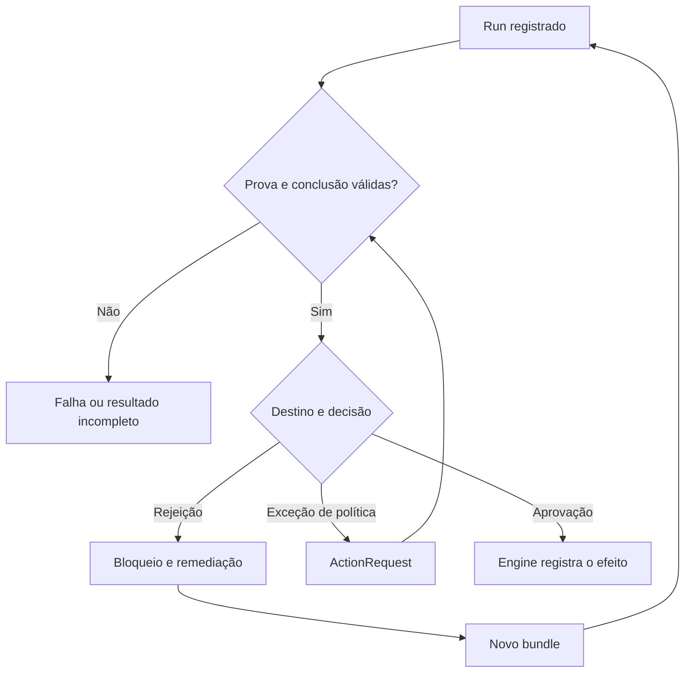

# POSE — frente 3: agentes secundários e revisão delegada

Data: 2026-10-11, America/Recife. Verificação em 2026-10-12 UTC.

Revisão fonte: `e68f3e7b3d1f056f1ef9a336e9422ea5ce9bd4c6`, após o merge do PR #148.
O código em `pose-mcp` permanece idêntico ao tag `v7.4.1`.
Escopo: análise; nenhuma correção, adoção de política ou conclusão de spec é efetuada por este documento.

Companions: [resultados e hashes](../results/2026-10-11-pose-front-03-delegated-review.json),
[probes sintéticos reproduzíveis](../results/2026-10-11-pose-front-03-dispatch-probes.py).
Continuidade: [índice](2026-10-11-pose-analysis-index.md),
[estado real](2026-10-11-pose-front-01-current-state.md) e
[cadeia de confiança](2026-10-11-pose-front-02-trust-chain.md).

## 1. Conclusão e limite da entrega atual

POSE já gera briefs e executa adapters de revisão em worktrees descartáveis.
Isso elimina parte do launcher pessoal e padroniza o pedido, a execução e seu
registro. Ainda não entrega a capacidade completa de revisão delegada autônoma:
o resultado não é interpretado, não prova independência, não recebe assinatura
do run, não entra automaticamente nos destinos de review/adjudication/smoke e
não satisfaz uma ActionRequest específica de revisão delegada.

O despacho atual também tem defeitos reproduzidos nas garantias que já declara:
a cota pode ser excedida por concorrência; mudanças podem escapar do controle
de integridade; uma preparação que falha não registra tentativa. Esses defeitos
merecem uma entrega corretiva própria, sem esperar pela adoção completa.

Há uma decisão arquitetural aceita que deve orientar o restante: **o engine
registra a conclusão de um run validado; pessoas entram por exceção de política**.
Não converter a falta dessa etapa em um procedimento universal de aplicação
manual. Vendor diferente é preferência, não obrigação; vendor **ou** modelo
diferente satisfaz a regra aceita quando a proveniência está verificada.
Review, adjudicação independente e smoke pertencem à primeira entrega completa.

As sete specs existentes são a base do trabalho. Três estão `done` e quatro
`draft`. Não há motivo para recriar o roadmap inteiro ou reapresentar brief e
dispatch como inéditos. Há motivo para corrigir seus limites, reconciliar as
specs restantes e exigir jornadas que demonstrem eficácia além da presença de
arquivos e de comandos.

## 2. Método e força das evidências

A inspeção cobriu o renderer, planejamento e execução do despacho, persistência,
CLI, isolamento por plataforma, testes, catálogo de capacidades, superfícies MCP,
closeout, histórico, métricas, ADR e as sete specs. Os IDs E01–E23 no final ligam
cada fonte à revisão imutável; o JSON contém seus hashes SHA-256.

Dez probes usaram o binário publicado 7.4.1, com SHA-256
`9ae6e0855c8b82599cab1d9999ae3a20644e091a5e0490b2f85d593294104d66`,
em novos repositórios temporários, adapters `sh` falsos e identidade genérica.
A fixture contém um grafo de entrega sintético baseado no teste do despacho;
seu resultado `integration:pass` não prova testes de um produto real. Nenhum
fornecedor de IA foi executado. Todas as escritas e adulterações, inclusive a
escrita fora do worktree, atingiram apenas fixtures temporários.

Três achados têm reprodução direta: T3-01, T3-02 e T3-03. Outros probes delimitam
capacidades ausentes, riscos declarados ou controles que funcionam. Não contar
cada variação de um mesmo achado como um novo defeito. `completed` é o valor
atual do estado de processo de `ReviewRun`; não significa review aprovada,
spec `done` ou closeout autorizado.

## 3. Reconciliação do contrato e das specs

| Artefato existente | Estado registrado | Código e comportamento observado | Trabalho restante nesta frente |
|---|---|---|---|
| `pose-delegated-review-contract` | `done` | ADR aceito com quatro respostas explícitas | Reconciliar textos provisórios restantes antes de iniciar as drafts |
| `pose-delegated-review-brief` | `done` | Três templates, digest, notas identificadas, recusa de bundle obsoleto | Precisar entradas do smoke, materialização do snapshot e contrato da resposta |
| `pose-delegated-review-dispatch` | `done` | Adapter configurável, preview, worktree, timeout, transcript e run; sem attestation | Corrigir as garantias já prometidas, especialmente R2–R4 |
| `pose-delegated-review-run-provenance` | `draft` | Run possui digests e metadados declarados; não há prova assinada do run | Vincular executor, configuração, entradas e conclusão; verificar independência |
| `pose-delegated-review-attempt-ledger` | `draft` | Criação exclusiva de arquivos; leitura permissiva e cota serial | Reserva atômica, integridade na leitura, linhagem, rejeições, recuperação e métricas |
| `pose-delegated-review-capability` | `draft` | Sem entrada `delegated-review` no catálogo ou finalização automática | Adotar opt-in; validar e encaminhar os três tipos; escalar só as exceções |
| `pose-delegated-review-action-fulfillment` | `draft` | Sem contrato específico conectando request a run validado | Cumprimento local/remoto e correlação íntegra com efeitos e destino |

O roadmap permanece `draft`, corretamente sem claim de entrega total. Sua
narrativa ainda trata respostas do maintainer como abertas. Provenance, ledger
e fulfillment dizem que o ADR aguarda aceitação e usam respostas provisórias;
o ADR está aceito desde 2026-10-09. Capability já incorpora as decisões.
O contrato R3 manda reconciliar cada spec antes de iniciá-la; portanto a pendência
editorial não exige reabrir decisões nem prova que drafts foram implementadas.

Fulfillment depende hoje apenas de dispatch. Isso é insuficiente para demonstrar
cumprimento confiável: associar um digest de brief a um run não valida a conclusão,
a assinatura ou a independência. Explicitar dependência da capacidade e da prova
verificada, ou publicar um contrato comum que todas consumam. Preservar os slugs
existentes e registrar os deltas ao iniciar cada spec.

## 4. O que o fluxo faz hoje

`RenderReviewBrief` resolve um bundle corrente, recusa ID superado e renderiza
escopo, entradas atribuídas, critérios, ferramentas, fatos estruturais e referências
de evidência. Ordena listas e identifica notas do implementador com fence variável,
evitando que uma sequência de backticks feche literalmente a seção. O template
instrui a reportar defeitos, não editar e não registrar atestações. [E01, E04]

O diff é uma referência: range, change sets e paths; o patch e o texto completo
da spec não vêm embutidos. Isso já aparece como risco residual da spec do brief.
Não tratar ausência de patch inline como feature prometida e esquecida. O adapter
precisa de acesso verificável ao material referido, inclusive Git e documentos
daquele snapshot. Head/base são observações do range; o conteúdo semântico do
bundle tem identidade própria. Não substituir sua verificação por `HEAD == commit`.

O smoke adiciona delivery targets e requisitos lendo `GetSpec` no store corrente.
Assim, sua renderização não depende literalmente apenas do objeto bundle. O
parser procura um heading `##` contendo `requirements` e linhas `- Rn:`. Suporte
a outros idiomas e formatos não se demonstra nessa rotina. É uma limitação
confirmada pelo código; não foi executada uma fixture pt-BR nem reproduzida uma
divergência entre spec corrente e bundle válido. [E01, E06]

`PlanReviewDispatch` lê `reviewers.json`, resolve o adapter, verifica a existência
do commit e conta runs daquele bundle com o mesmo nome de adapter. `RunReviewDispatch`
usa essa contagem, cria worktree detached, passa o brief por stdin, substitui
`{output}` no argv e executa com timeout. Captura stdout/stderr, lê o arquivo de
output se existir e checa mudanças por `git status` e a permanência de HEAD.
Registra transcript e JSON no repositório original. [E02, E03]

Timeout, saída não zero e alterações ordinárias de conteúdo geram run `failed`.
No Unix, processo e filhos no mesmo grupo são encerrados; testes cobrem timeout,
filho remanescente e rename de conteúdo para diretório derivado. Essas correções
já existem. No Windows, as funções de grupo são vazias: timeout encerra o processo
principal e WaitDelay solta pipes; contenção dos descendentes não está implementada
por esse mecanismo. Não generalizar a garantia Unix a todas as plataformas. [E05, E07, E08]

Sem adapter configurado, a CLI oferece brief e exemplo de configuração. Com
adapter, `--apply` executa; preview não executa. Após o run a CLI diz explicitamente
que nenhuma attestation foi registrada. O dispatch não chama o issuer, preflight
ou recorder de conclusões. Também não encontramos ferramenta MCP específica
de dispatch nem integração de ReviewRun no closeout ou insights inspecionados.
Isso delimita a superfície atual; não significa que POSE inteiro careça de MCP,
orquestração ou ActionRequest. [E03, E09–E13]

## 5. Probes e controles

| Probe | Resultado observado | Conclusão permitida |
|---|---|---|
| Output vazio, processo exit 0 | `completed`, output vazio, zero attestations | Estado de execução não valida conclusão; falta prevista da capability |
| Dois dispatches concorrentes, máximo 1 | Dois exit 0, dois runs `completed` | A cota não possui reserva atômica |
| Edição ordinária de `lib.go` | Exit 1, run `failed`, arquivo citado | Controle básico de alteração funciona |
| `assume-unchanged` seguido de edição | Exit 0, `completed`, zero attestations | Git status não prova imutabilidade dos bytes |
| Git shim falha somente no status pós-run | Exit 0, `completed` | Erro da verificação de mudanças é ignorado |
| Adapter escreve na raiz original do fixture | Exit 0, `completed`, arquivo criado fora do worktree | Worktree não é sandbox de filesystem |
| Alterar adapter/output do JSON e transcript | Segundo run permitido apesar de máximo 1 | Contagem lê conteúdo adulterado sem verificar identidade/prova |
| Duas respostas `changes-requested`, máximo 2 | Dois `completed`, mesmo bundle e brief | Ledger de rejeições e rerun com reason ainda não existe |
| Timeout de 100 ms | Exit 1, `failed`, timeout identificado | Controle de timeout funciona nesse ambiente Unix |
| Git shim recusa criação de worktree | Exit 1, zero run records | Falha de preparação perde rastreabilidade |

Esses resultados não demonstram exploração remota, acesso a credenciais,
adulteração do repo real ou bypass completo do closeout. Os shims provocam erros
determinísticos apenas no fixture. A adulteração do ledger mostra a confiança da
leitura e a contagem de orçamento; não prova que o engine hoje aceita um run
adulterado como attestation, pois essa integração ainda não existe.

## 6. Backlog consolidado com aceite e responsabilidade

Prioridades propostas: P1 é correção de garantia atual ou pré-requisito da
capacidade completa; P2 é melhoria operacional necessária à adoção consistente.
São candidatos a trabalho futuro, não issues adjudicadas nem compromissos de versão.

### T3-01 — reservar orçamento e registrar toda tentativa (P1, reproduzido)

A contagem ocorre no planejamento e não há reserva antes de iniciar o processo.
Dois planos veem zero e ambos executam com máximo um. Uma falha em MkdirTemp ou
worktree add retorna antes de `finish`, deixando zero registros. O run começa
apenas em memória; crash antes da gravação final também perde a tentativa.
Transcript e JSON são publicados sequencialmente, sem transação conjunta ou
recuperação de órfãos. A última condição é inspeção, não crash reproduzido. [E02]

Corrigir a reserva no dispatch e estender `attempt-ledger` com estados duráveis
de tentativa, término e falha de preparação. Diferenciar tentativa realmente
executada de recusa por cota; hoje recusas também criam runs contados depois.
Escolher a semântica de cota por bundle, tipo e identidade do adapter, deixando
explícito se aliases compartilham orçamento. Um nome novo não deveria esconder
as tentativas do mesmo executor. Número de tentativas não mede tokens ou custo.

Aceite: em N requests concorrentes para cota K, no máximo K adapters iniciam;
cada início tem registro anterior durável; setup failure, cancelamento e crash
deixam estado recuperável; retry com mesma chave não executa duas vezes; registros
parciais não desaparecem silenciosamente. A frente 9 define o padrão transversal
de lock, idempotência e recuperação; esta frente valida o cenário de review.

### T3-02 — verificar o snapshot de verdade (P1, reproduzido)

`git status` ignora bytes marcados assume-unchanged; a rotina também descarta seu
erro. Ambos produzem `completed` após uma edição. O parser textual de porcelain
não usa `-z`, ficando dependente de quoting, separadores e nomes de arquivo.
A permissão ampla de prefixes derivados aceita qualquer arquivo sob indexes,
results e review-bundles, sem verificar se é realmente regeneração autorizada.
Essa última observação é fonte, não adulteração de validation-matrix reproduzida.

Compare conteúdo materializado com os digests/entradas selados, recuse estado
desconhecido e leia paths sem ambiguidades. Distinga outputs regeneráveis dos
inputs de política e evidência; produzir uma assessment não deve autorizar a
alteração de qualquer índice. Valide os inputs antes da execução e novamente
antes de consumir o resultado, pois política ou bundle podem mudar durante ela.

Aceite: edição com assume-unchanged/skip-worktree, erro Git, rename e nomes com
espaços, aspas ou caracteres não ASCII não passam; regeneração autorizada continua
possível; bundle superado durante o run preserva sua história mas não produz
efeito sobre o escopo atual. Vincular as garantias à identidade semântica do bundle,
sem impor que qualquer commit documental invalide uma revisão válida. [E01, E02, E14]

### T3-03 — verificar ledger e impedir apagar rejeições por rerun (P1, reproduzido)

`O_EXCL` impede sobrescrita pelo recorder, não torna o arquivo append-only para
outros atores. `ListReviewRuns` aceita JSON com run_id preenchido sem verificar
schema, identidade de conteúdo, transcript ou assinatura; arquivos ilegíveis e
JSON inválido são ignorados. Alterar `adapter` evita a contagem da tentativa.
O output `changes-requested` ainda é só texto; repetir o mesmo bundle é permitido
até a cota serial. `history-check` olha JSONL de reports/history, não review-runs.
Isso coincide com trabalho já previsto na draft `attempt-ledger`. [E02, E10, E18]

Preserve rejeições verificadas e relações de supersession, revele corrupção e
ausência de prova, valide identidade ao ler e vincule conclusão ao run. Uma razão
de rerun documenta uma exceção; não apaga a rejeição nem autoriza aprovação de
bundle inalterado contrariando capability R5. Reconcilie ledger R2 com essa regra:
uma tentativa diagnóstica pode ser autorizada, mantendo o bloqueio original.

Aceite: alteração ou remoção de run/transcript é visível e não restaura orçamento
nem aprovação; troca de alias/modelo preserva linhagem; verify mostra rejeições
anteriores; uma correção e novo bundle permitem novo julgamento; execução sem
mudança exige reason quando permitida. A assinatura não prova que não existiu
um registro apagado: definir âncora de histórico/retensão verificável, conforme
frentes 2 e 9, em vez de prometer imutabilidade a partir de hash isolado.

### T3-04 — provar execução e independência (P1, fonte e lacuna planejada)

Vendor e model são copiados da configuração; nada confirma que o comando rodou
esse modelo. Digests existem, mas o run não é assinado, não referencia identidade
da implementação e não tem configuração/argv versionados. O transcript pode
ser distinto do output final lido de `{output}`; assinar só o transcript não
vincula os bytes da conclusão. A identidade atual inclui output no hash inicial,
mas não há verificador desse run na leitura. [E02, E15, E17]

Implementar `run-provenance` reutilizando issuer e cadeia de confiança. Selar
bundle, tipo, versão do template, notas, policy/config digest, adapter/executor,
modelo/vendor da implementação e revisão, horários, término, transcript e output
final. O brief digest atual é o hash do corpo antes do footer; stdin contém o
footer. Documentar a canonicalização e, se necessário, guardar também digest dos
bytes transmitidos, evitando comparar o hash do stdin com o corpo como se fossem
iguais. Não criar um segundo issuer concorrente.

Aceite: run/claim/resultado divergentes são rejeitados; chave não autorizada e
prova incompleta não satisfazem different-actor; vendor ou modelo diferente
com prova válida satisfaz, mesmo com mesmo vendor; prefixo declarado não satisfaz
em instância adotante. Revelar o limite: assinatura do executor vincula sua
declaração; não é prova independente do fornecedor se não houver receipt dele.
O principal é machine-attested, sem atribuição fictícia a uma pessoa.

### T3-05 — validar a conclusão e gravar os três destinos (P1, fonte e lacuna planejada)

Processo exit 0 com output vazio é um run `completed`. Isso é aceitável como
estado de execução, mas insuficiente para uma conclusão consumível. O brief
pede prosa, e `failed` por critério precisa tradução para os findings e dispositions
do contrato de attestation; não há parser/admissibilidade implementados no
despacho. Adjudication pede veredictos por questão, smoke por observação; nenhum
tem hoje gravação no destino pelo dispatcher. [E01–E03, E19]

Definir envelope versionado de resultado com decision, critérios, disposições,
evidência referenciada, findings e escalations. Separar erros de execução,
conclusão incompleta, rejeição válida e aprovação válida. Cada kind deve ter
validador e destino tipados: review → attestation; adjudication → decision record;
smoke → evidência do target. Rejeição válida também é registrada e bloqueia,
em vez de ser descartada como erro técnico.

Aceite: vazio, saída truncada, critério ausente, ferramenta omitida, evidência
errada, contradição entre decisão e finding, output estrangeiro ou bundle
superado não produzem efeito; aprovação completa válida é registrada pelo
engine sem passo manual; rejeição permanece consultável. Pré-requisito: corrigir
a paridade de preflight/write da frente 2, T2-02, e a prova na leitura. Não
inferir eficácia da mera obtenção de um envelope assinado.

### T3-06 — declarar isolamento, recursos e retenção (P1, fonte e limite confirmado)

O worktree compartilha metadados Git e o processo herda o ambiente. Ele não
impede escrita fora de sua raiz, rede ou leitura de credenciais disponíveis ao
executor; o probe confirmou apenas uma escrita externa no fixture. A spec
dispatch já reconhece que o adapter precisa honrar read-only. Preservar esse
limite explícito, sem vender worktree como sandbox. [E02, E05, E07, E08, E16]

stdout/stderr usam buffer sem limite; o arquivo output é lido inteiro; o tail
de 20.000 bytes limita só o output de fallback persistido, não memória nem
transcript. A duração é parseada, mas zero/negativo passa; cota zero/negativa
desabilita o limite. Não há validação de valores whitespace de identidade,
retenção ou redaction aplicada ao transcript nessa rotina. Permissão 0644 é
sujeita a umask, não constitui política de confidencialidade.

Declare capacidades exigidas do adapter: filesystem, Git, rede, ambiente,
segredos, filhos e limites de tamanho/tempo. Use ambiente mínimo ou política
explícita de passagem; preserve autenticação necessária sem copiar material de
chaves para o brief. Limite streams e trate truncamento como incapacidade de
validar o resultado. Defina retenção, acesso e exportação dos artifacts; redaction
e assinatura precisam ter ordem declarada para a prova continuar verificável.

Aceite: adapters incompatíveis com a política não executam; duração/cota inválidas
não viram ausência silenciosa de limites; tamanho máximo e cleanup têm provas;
Unix e Windows declaram suas garantias reais; falha de cleanup aparece no estado.
Não prometer suporte Windows completo só porque o comando compila. Containers
ou sandbox externo são alternativas de execução, sem tornar um fornecedor
específico dependência obrigatória de POSE.

### T3-07 — fornecer contexto suficiente e preservar autoridade (P2, fonte)

O brief gerado reduz autoria manual do pedido, mas spec, critérios, tools e
notas continuam sendo dados de fontes potencialmente controladas pela parte
revisada. Fences e rótulos não provam que um modelo obedecerá. As evidências
renderizadas mostram classe, ID e outcome, deixando módulo, provenance, subject
e observação carried-forward/unknown fora dessa seção. O reviewer pode buscá-los,
mas o contrato precisa tornar esse acesso explícito e verificável. [E01, E14]

Materialize um pacote de inputs selados ou referências resolvíveis verificadas;
use o parser canônico da spec para smoke e preserve IDs de requisitos/targets.
Não recomputar observações de smoke de documentos atuais sem demonstrar vínculo
com os inputs selados. Distinguir instrução do engine, regra adotada e conteúdo
revisado; não aceitar texto de fonte como autorização de tool ou mudança de
escopo. A tradução de Args para uma string deve preservar sua representação,
sem induzir execução por shell de conteúdo arbitrário.

Aceite: notas adversariais não alteram critérios, destino ou permissões do
engine; mudança de template/notas/inputs muda a identidade adequada; evidencia
carried-forward e cobertura inferida são reveladas; smoke cobre requisitos em
formatos suportados e recusa inputs incompletos; diff e documentos são legíveis
no snapshot certo. A robustez do resultado é verificada no engine, não prometida
como obediência absoluta do modelo ao prompt.

### T3-08 — cumprir requests e escalar só as exceções (P1, fonte e lacuna planejada)

Capability R6 já nomeia os casos humanos: critério de pessoa, conflito, decisão
de negócio e orçamento esgotado sem aprovação. Hoje o dispatch retorna falha
de cota e texto; não abre automaticamente esses pedidos. Fulfillment R2 cita
matching de brief digest, que deve ser condição necessária, não validação total
do cumprimento. [E19, E20]

Conectar request a escopo, bundle, tipo, accepted adapters, execução e destino,
com idempotência e principal autorizado. Distinguir pedido operacional resolvível
por runner de aprovação humana exigida por política. Um run de agente não pode
satisfazer a exigência de pessoa; uma pessoa não deve receber comandos manuais
quando a decisão é apenas confirmar uma opção.

Aceite: request local e remoto usam o mesmo verificador; replay ou run para
outro target não satisfaz; budget exhausted produz pergunta com opções; conflito
e business decision retêm evidência e contexto; retorno após mudança de bundle
exige correlação válida. Reutilizar ActionRequest; frente 4 governa classificação,
pergunta, efeito e satisfação, frente 2 governa prova. Não afirmar integração
Harne8 pronta: seu código não foi inspecionado nesta frente; demonstrar runner
CI e especificar o contrato de fronteira antes de prometer compatibilidade.

### T3-09 — integrar adoção, closeout e observabilidade (P2, fonte)

O closeout atual mantém judgment `waiting` até conclusão do reviewer; não chama
dispatch. É comportamento coerente enquanto a capacidade ainda não existe.
Capability deve acrescentar o caminho autônomo em instâncias adotantes, mantendo
histórico e compatibilidade para instâncias não adotantes. [E09, E11–E13, E19]

Aceite: adoção recusa ausência de adapter apto; preview expõe o que executará;
workflow/skill orienta dispatch e remediação sem loops de aprovação; CLI e MCP
necessários à jornada têm a mesma validação e semântica. Medir attempts, recusas,
rejeições, mudanças entre runs, duração, escalations e corrupção. Approval rate
por adapter é diagnóstico, não meta que incentiva trocar pelo mais permissivo.
Frente 7 avalia UX e anti-mecanização, frente 8 processo residente/performance,
frente 10 publicação e adoção documental. Não recriar engines por superfície.

### T3-10 — reconciliar plano de entrega e evidência de eficácia (P2, fonte)

Reutilizar as sete specs; atualizar as drafts obsoletas, dependências, artifacts
e delivery targets antes de execução. Affected areas e checklist da capability
ainda resumem catálogo/docs/skill/journey, embora R5–R7 exijam finalizador, tipos
de output e escalations. Não deixar esses requisitos fora do plano técnico.

Aceite: roadmap e specs concordam com ADR e código; cada R tem teste que prova
comportamento, não só campo presente; nenhuma parte declara capacidade completa
antes das jornadas dos três kinds. A análise não muda status de specs antigas
por retroatividade; novos defeitos ficam rastreados como correções verificáveis.

## 7. Composição de entregas futuras

| Entrega proposta | Escopo consistente | Specs a reutilizar ou complementar | Gate de saída |
|---|---|---|---|
| A — despacho com garantias corrigidas | Cota atômica, falhas registradas, snapshot verificado, limites claros de execução | Correção do dispatch; fundação do attempt-ledger; T3-01/02/06 | Probes de concorrência, setup failure e alteração deixam de passar indevidamente; controles existentes continuam válidos |
| B — capacidade completa opt-in | Proveniência, ledger, resultado tipado, finalização engine, três kinds, exceções e request fulfillment local/remoto | As quatro drafts existentes; deltas T3-03/04/05/07/08/09/10; pré-requisitos da frente 2 | Defeito → rejeição persistida → correção → novo bundle → aprovação → closeout sem aplicação manual; adjudication e smoke com destinos; exceção humana e runner remoto demonstrados |

A pode sair antes e continuar sendo uma melhoria de dispatch. Não anunciá-la
como revisão autônoma completa. B pode ser construída em PRs menores, mas sua
release só é suficiente quando atravessa a jornada inteira. Se trust sair antes
de adoption, nomear a entrega como infraestrutura e manter a capability desligada.
O número/semver de release fica para frentes 6 e 10, após consolidar compatibilidade,
dependências transversais e suficiência; este relatório não promete uma versão.

Estado alvo do julgamento, distinto do estado do processo:



Uma resposta à request retorna à validação; não gera aprovação por si só.
Review/adjudication/smoke compartilham prova e execução, mantendo destinos e
semânticas próprios. Não transformar esse fluxo em scheduler geral, plataforma
de fornecedores ou executor de comandos sem escopo.

## 8. Verificação exigida para considerar B eficaz

Use fake adapters para provas determinísticas; um piloto com fornecedor real
é evidência complementar de integração, sem tornar a suíte dependente dele.
O teste atual confirma transporte e metadados dos três kinds, não suas conclusões.
Uma execução real relatada na spec de dispatch encontrou defeito; isso é evidência
histórica pontual, não taxa de eficácia do mecanismo completo.

1. Injetar um defeito alcançável. Registrar rejeição, impedir rerun que apague o
   resultado, corrigir, selar novo bundle e concluir sem aplicação humana.
2. Repetir para adjudication com questão e decisão identificadas, e smoke com
   target, requisitos e observações que cheguem à evidência correta.
3. Exercitar pessoa por política, conflito, business decision e cota esgotada;
   requests devem conter pergunta e opções suficientes, sem satisfações espúrias.
4. Concorrer, interromper, recuperar e fazer replay. Adulterar JSON/transcript/output,
   trocar chave, usar bundle obsoleto e mudar política durante execução.
5. Demonstrar execução local e CI remoto no mesmo contrato, ausência de efeitos
   no repo original conforme política e compatibilidade sem adoção.

O baseline possui testes de determinismo, notas, staleness, smoke script, cota
serial, edição, timeout, filhos e rename. Mantê-los; acrescentar cobertura das
garantias ausentes em vez de propor novamente correções já entregues.

## 9. Fontes, reprodução e validação deste documento

Para repetir os dez probes em Unix, forneça explicitamente o binário publicado:

```sh
python .pose/results/2026-10-11-pose-front-03-dispatch-probes.py \
  --binary /absolute/path/to/pose \
  --output /tmp/pose-front03-probes.json
```

O harness preserva os fixtures temporários e informa seu diretório. Não executa
o dispatcher no checkout auditado, não chama adapters reais e não requer tokens.
A corrida depende de agendamento; repetir se o ambiente serializar os processos.
Resultados observados nesta análise constam do JSON, independentemente de uma
execução posterior em código corrigido. O harness registra observações, não deve
virar teste que exige a continuidade dos defeitos.

<!-- validation-summary -->
`pose check --strict` passou em 2026-10-12 UTC, com 30 avisos preexistentes:
27 de changelog, dois de capability assessment e um de stamp da instância.
JSON, dez IDs únicos, 23 hashes de fontes, hash do harness, estados das sete specs,
links relativos, sintaxe Python e whitespace do diff foram conferidos. O harness
versionado foi executado e reproduziu os dez resultados da execução inicial.
A [CI da baseline](https://github.com/oseiaspereira88/pose/actions/runs/38195019353)
terminou com sucesso; isso é evidência separada da verificação documental local.
<!-- /validation-summary -->

Limites: a suíte Go não foi reexecutada localmente, pois Go não está disponível;
o código foi inspecionado e probes executaram o release publicado. A CI da baseline
foi consultada separadamente. Não foi demonstrada adoção real, execução de vendors,
integração Harne8, sandbox multiplataforma ou bypass end-to-end do closeout.

<!-- source-list -->
- **E01** — [`pose-mcp/internal/pose/review_brief.go`](https://github.com/oseiaspereira88/pose/blob/e68f3e7b3d1f056f1ef9a336e9422ea5ce9bd4c6/pose-mcp/internal/pose/review_brief.go)
- **E02** — [`pose-mcp/internal/pose/review_dispatch.go`](https://github.com/oseiaspereira88/pose/blob/e68f3e7b3d1f056f1ef9a336e9422ea5ce9bd4c6/pose-mcp/internal/pose/review_dispatch.go)
- **E03** — [`pose-mcp/internal/cli/review_dispatch.go`](https://github.com/oseiaspereira88/pose/blob/e68f3e7b3d1f056f1ef9a336e9422ea5ce9bd4c6/pose-mcp/internal/cli/review_dispatch.go)
- **E04** — [`pose-mcp/internal/pose/review_brief_test.go`](https://github.com/oseiaspereira88/pose/blob/e68f3e7b3d1f056f1ef9a336e9422ea5ce9bd4c6/pose-mcp/internal/pose/review_brief_test.go)
- **E05** — [`pose-mcp/internal/cli/review_dispatch_test.go`](https://github.com/oseiaspereira88/pose/blob/e68f3e7b3d1f056f1ef9a336e9422ea5ce9bd4c6/pose-mcp/internal/cli/review_dispatch_test.go)
- **E06** — [`.pose/specs/2026-10-09-pose-delegated-review-brief.md`](https://github.com/oseiaspereira88/pose/blob/e68f3e7b3d1f056f1ef9a336e9422ea5ce9bd4c6/.pose/specs/2026-10-09-pose-delegated-review-brief.md)
- **E07** — [`pose-mcp/internal/pose/review_dispatch_unix.go`](https://github.com/oseiaspereira88/pose/blob/e68f3e7b3d1f056f1ef9a336e9422ea5ce9bd4c6/pose-mcp/internal/pose/review_dispatch_unix.go)
- **E08** — [`pose-mcp/internal/pose/review_dispatch_windows.go`](https://github.com/oseiaspereira88/pose/blob/e68f3e7b3d1f056f1ef9a336e9422ea5ce9bd4c6/pose-mcp/internal/pose/review_dispatch_windows.go)
- **E09** — [`pose-mcp/internal/pose/closeout_plan.go`](https://github.com/oseiaspereira88/pose/blob/e68f3e7b3d1f056f1ef9a336e9422ea5ce9bd4c6/pose-mcp/internal/pose/closeout_plan.go)
- **E10** — [`pose-mcp/internal/cli/historycheck.go`](https://github.com/oseiaspereira88/pose/blob/e68f3e7b3d1f056f1ef9a336e9422ea5ce9bd4c6/pose-mcp/internal/cli/historycheck.go)
- **E11** — [`pose-mcp/internal/pose/capability_catalog.go`](https://github.com/oseiaspereira88/pose/blob/e68f3e7b3d1f056f1ef9a336e9422ea5ce9bd4c6/pose-mcp/internal/pose/capability_catalog.go)
- **E12** — [`pose-mcp/internal/mcpserver/catalog.go`](https://github.com/oseiaspereira88/pose/blob/e68f3e7b3d1f056f1ef9a336e9422ea5ce9bd4c6/pose-mcp/internal/mcpserver/catalog.go)
- **E13** — [`pose-mcp/internal/pose/insights.go`](https://github.com/oseiaspereira88/pose/blob/e68f3e7b3d1f056f1ef9a336e9422ea5ce9bd4c6/pose-mcp/internal/pose/insights.go)
- **E14** — [`pose-mcp/internal/pose/review_bundle.go`](https://github.com/oseiaspereira88/pose/blob/e68f3e7b3d1f056f1ef9a336e9422ea5ce9bd4c6/pose-mcp/internal/pose/review_bundle.go)
- **E15** — [`.pose/adr/2026-10-09-delegated-review-is-an-adapter.md`](https://github.com/oseiaspereira88/pose/blob/e68f3e7b3d1f056f1ef9a336e9422ea5ce9bd4c6/.pose/adr/2026-10-09-delegated-review-is-an-adapter.md)
- **E16** — [`.pose/specs/2026-10-09-pose-delegated-review-dispatch.md`](https://github.com/oseiaspereira88/pose/blob/e68f3e7b3d1f056f1ef9a336e9422ea5ce9bd4c6/.pose/specs/2026-10-09-pose-delegated-review-dispatch.md)
- **E17** — [`.pose/specs/2026-10-09-pose-delegated-review-run-provenance.md`](https://github.com/oseiaspereira88/pose/blob/e68f3e7b3d1f056f1ef9a336e9422ea5ce9bd4c6/.pose/specs/2026-10-09-pose-delegated-review-run-provenance.md)
- **E18** — [`.pose/specs/2026-10-09-pose-delegated-review-attempt-ledger.md`](https://github.com/oseiaspereira88/pose/blob/e68f3e7b3d1f056f1ef9a336e9422ea5ce9bd4c6/.pose/specs/2026-10-09-pose-delegated-review-attempt-ledger.md)
- **E19** — [`.pose/specs/2026-10-09-pose-delegated-review-capability.md`](https://github.com/oseiaspereira88/pose/blob/e68f3e7b3d1f056f1ef9a336e9422ea5ce9bd4c6/.pose/specs/2026-10-09-pose-delegated-review-capability.md)
- **E20** — [`.pose/specs/2026-10-09-pose-delegated-review-action-fulfillment.md`](https://github.com/oseiaspereira88/pose/blob/e68f3e7b3d1f056f1ef9a336e9422ea5ce9bd4c6/.pose/specs/2026-10-09-pose-delegated-review-action-fulfillment.md)
- **E21** — [`.pose/specs/2026-10-09-pose-delegated-review-contract.md`](https://github.com/oseiaspereira88/pose/blob/e68f3e7b3d1f056f1ef9a336e9422ea5ce9bd4c6/.pose/specs/2026-10-09-pose-delegated-review-contract.md)
- **E22** — [`.pose/roadmaps/delegated-review.md`](https://github.com/oseiaspereira88/pose/blob/e68f3e7b3d1f056f1ef9a336e9422ea5ce9bd4c6/.pose/roadmaps/delegated-review.md)
- **E23** — [`.github/workflows/ci.yml`](https://github.com/oseiaspereira88/pose/blob/e68f3e7b3d1f056f1ef9a336e9422ea5ce9bd4c6/.github/workflows/ci.yml)
