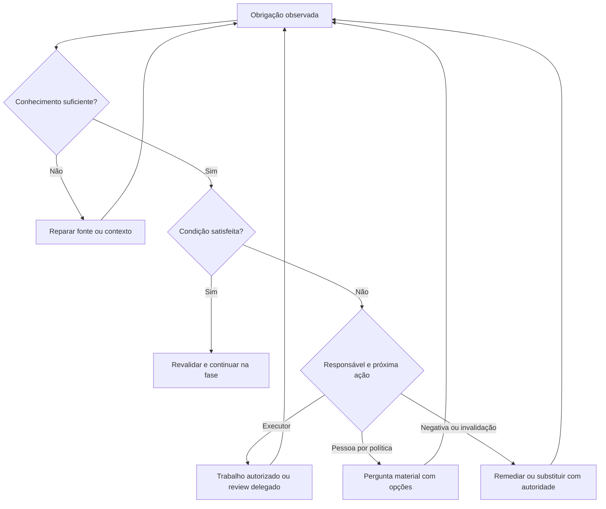

# POSE — frente 4: pendências, ações humanas, obrigações e bloqueios

Data: 2026-10-12, America/Recife. Revisão fonte:
`85486b3de14261818e2fcd6159f60e6b51118a1e`, após o merge do PR #149.
O código em `pose-mcp` permanece idêntico ao tag `v7.4.1`.

Escopo: análise consolidada; não altera engine, políticas adotadas, answers,
follow-ups ou estados das specs. Resultados e fontes:
[JSON](../results/2026-10-12-pose-front-04-actions-obligations.json) e
[harness reproduzível](../results/2026-10-12-pose-front-04-action-probes.py).
Continuidade: [índice](2026-10-11-pose-analysis-index.md),
[frente 2](2026-10-11-pose-front-02-trust-chain.md) e
[frente 3](2026-10-11-pose-front-03-delegated-review.md).

## 1. Conclusão

POSE já tem o mecanismo central de obrigações e pedidos materiais. A análise
de outubro que apontava falta de centralização é contexto histórico: o código
atual projeta 13 fontes, persiste ActionRequest, distingue resposta de satisfação,
agrupa perguntas, apresenta restrições por fase e aplica gates adotados. Recriar
esse modelo desperdiçaria as entregas recentes.

O problema restante é a transmissão consistente dessas garantias. Os probes
confirmaram aplicação de restrições ao escopo errado, dispensa sem prova sob
política verificada, supersession por terceiro que retira a condição anterior,
descompasso entre apresentação e resolução, referências semanticamente erradas
e identidade de snapshot que não acompanha uma alteração do journal. Há também
diferenças entre latência de resposta e duração do bloqueio que as métricas
atuais não representam completamente.

Recomendar duas entregas: primeiro corrigir autoridade, escopo, referência e
consistência das leituras; depois completar a jornada operacional e de recuperação,
incluindo apresentação, preflight, métricas e integração com a revisão delegada.
Preservar os ADRs: obrigações derivadas não ganham outro ledger, Attention não
vira gate, uma dúvida comum não vira ActionRequest e o core não ganha scheduler.

Uma pendência de reviewer não significa, por si só, dependência de pessoa. A
frente 3 é o caminho para resolução por agente secundário validado. Exigência
humana deve vir de autoridade e política aplicáveis, com pergunta material e
opções prontas, sem substituir desenvolvimento autônomo por etapas manuais.

## 2. Método, baseline e limites

Inspecionar fontes E01–E43, testes, contratos, superfícies CLI/MCP, manual,
specs e roadmap. Cada fonte ao final tem link para a revisão imutável e hash
no companion. Inspecionar código como verdade comportamental; usar specs e ADRs
para avaliar intenção, não para presumir que uma garantia já funciona.

Executar 15 cenários sintéticos com o release 7.4.1, SHA-256
`9ae6e0855c8b82599cab1d9999ae3a20644e091a5e0490b2f85d593294104d66`.
Todos os writes ocorrem em repositórios Git temporários com principals genéricos.
O cenário de métricas usa horários históricos explicitamente sintéticos. Um
cenário importa o shape tipado de effect.scope, não exposto pelos flags de open,
com digest material e ID derivados recalculados, aceitos pelo reader; não é answer assinada
adulterada. Nenhum
vendor, credencial real, operação externa, publicação ou repo de produto foi
acionado. O harness preserva fixtures para inspeção.

Oito candidatos têm apoio em cenários executados, mas não são oito bugs de
segurança: roteamento literal de ator, preview parcial e auditoria de recusas
incluem decisões de contrato/UX a reconciliar. Os outros dois candidatos são
integração e eficácia propostas a partir das fontes. Não confundir quantidade
de cenários com quantidade de defeitos independentes.

Na leitura real anterior às edições desta análise, `pose state --attention --json`
retornou `complete: true`, todos os 13 producers `current` e 112 obrigações:

| Categoria | Quantidade | Interpretação na baseline |
|---|---:|---|
| `dependency` | 2 | Capability de revisão delegada espera provenance e attempt-ledger |
| `judgment` | 1 | Review de `pose-update-dry-run-reports-the-whole-update` ainda não aprovada |
| `evidence` | 1 | Assessment de pose-mcp desatualizada; efeito consultivo |
| `residual-debt` | 108 | Follow-ups abertos; não são gates por padrão |

Attention mostrou duas restrições de start/execution, uma de closeout,
um item `for_actor`, três `gates` e 108 residuais. O nome `gates` nesse agrupamento
não significa que todos bloqueiam: um dos três é a assessment consultiva.
`pose action list --json` retornou sete requests, todas `decision`, `answered`,
`satisfied`, com assurance `declared`. `agency_readiness_version` é 1 e o
papel maintainer tem holder configurado. Isso demonstra configuração e uso
pontual do fluxo; não é prova de autorização humana verificada ou eficácia
universal. A ausência de requests na consulta padrão tem limites de escopo,
demonstrados em T4-01.

## 3. Modelo correto: fatos e efeitos diferentes

| Conceito | Fonte de verdade | O que responde | O que não se deve inferir |
|---|---|---|---|
| Lifecycle da spec | Spec/start/closeout | Estágio do artefato | Que todo trabalho está bloqueado por uma pendência |
| Obligation | Projeção do domínio produtor | Condição, ator, conhecimento, espera e efeitos | Uma resolução independente registrada na agregação |
| ActionRequest | Journal `.pose/actions/*.jsonl` | Pergunta material, opções, autoridade, alvos e respostas | Que toda interação ou escolha reversível exige pedido |
| Satisfaction | Fonte de cada condição | Se a condição foi cumprida, dispensada, cancelada ou invalidada | Que qualquer resposta autoriza a operação |
| Knowledge/coverage | Observação e producer coverage | O que foi possível observar | Que ausência de dados significa ausência de obrigação |
| Effect | Fase, scope e mode | Onde a condição restringe ou aconselha | Restrição global só porque existe uma pendência |
| Attention | Agrupamento da projeção | O que examinar, quem precisa agir e onde há restrição | Permissão para write ou necessidade automática de pessoa |
| Gate adotado | Ponto de transição | Se start/close/freeze pode acontecer | Que apresentação de um item é enforcement |

`blocked` segue lido por compatibilidade, mas `Readiness.Terminal` não o trata
como resultado terminal. Dependências declaradas explicam sua causa; sem causa
registrada, a readiness revela `unknown`. Phases mantêm o significado legado de
`Ready` e apresentam `clear`, `restricted`, `partially-restricted` ou `unknown`.
Restrição parcial não prova independência do restante. Essas decisões já estão
implementadas; não voltar a propor uma família de status `waiting-*`. [E05, E11, E25]

Os cinco kinds têm condições diferentes: decision aceita uma opção admitida;
approval só satisfaz com approve; acceptance com accept; external-operation com
done e referência de evidência; input com texto não vazio. Uma decision escolhida
resolve a pergunta, não implementa automaticamente sua consequência na spec ou
autoriza todos os caminhos. Esse efeito continua pertencendo ao domínio consumidor.
Escolher o kind errado pode enfraquecer a intenção do pedido mesmo com schema válido.

## 4. Fluxo existente e superfícies

`ProjectObligations` reutiliza um snapshot de specs, consulta producers em paralelo,
concatena em ordem fixa, valida itens e aplica filtros. Producer que retorna erro
fica `unavailable`; sua ausência não vira zero confiável. A projeção é read-only.
Não existe estado agregado de resolução a sincronizar com a fonte. [E01, E06, E23]

O registro de 13 fontes contém readiness, closeout, review, start, followups,
action-requests, assessments, premises, falsifiers, docs-review, capability-trigger,
release e findings. As quatro fontes de projeto acrescentadas em 2026-10-09
rodam em cada consulta e têm efeitos consultivos, conforme ADR aceito. Isso é
entrega existente, não lacuna de produtor pendente. Seu contexto global deve
ficar distinto das restrições locais; não exigir ligação fictícia a uma spec
para produzir um item que pertence ao projeto. [E06, E07, E26, E33]

`PrepareActionRequest` exige origem existente, question, requester válido,
opções/consequências, targets e effects válidos sintaticamente. Vincula subject
opcional, calcula RequestDigest e um ID que também inclui instante de abertura,
principal e supersedes. Reabrir o mesmo prepared request no mesmo instante é
idempotente; isso não é deduplicação semântica de pedidos de sessões diferentes.

`ResolveActionRequest` exige digest, expected revision e idempotency key; valida
opção e autoridade, verifica prova de answers conforme política e grava sob lock,
com `file.Sync`. Replay idêntico não adiciona evento; conflito não troca a resposta.
`ListActionRequests` retorna erro de journal malformado, sem ignorá-lo silenciosamente.
Esses controles são úteis e devem permanecer. [E02, E03, E20, E21]

CLI permite answers declaradas em política declarada, revelando a limitação.
MCP exige prova para `pose_action_resolve` mesmo nesse modo. A diferença é
explícita: transporte de agente não deve tornar uma string `human:` confirmação
observada. Ela já foi decidida; não corrigir a paridade permitindo resposta
declarada via MCP. Ler/listar/open/obligations usa o mesmo domínio. [E13–E15, E30]

`PresentActionRequests` agrupa por origem e primeira fase bloqueante, mantendo
ID/digest/revision de cada pergunta. Start/execution interrompem primeiro;
release-only pode esperar. Answered, waived e cancelled não são perguntadas
novamente por padrão. Já existe correção que retira obrigações resolvidas de
`for_actor` e `gates`; não reapresentá-la como pendência de implementação. [E09, E24, E28]

Os gates adotados consultam requests, enquanto dependências, review e evidência
mantêm seus gates próprios. Start recompõe o plano antes de aplicar. Closeout
leva o diagnóstico `action-request-pending` para a transição de spec. Release
recusa o freeze em `release prepare`; não recusa registrar publicação que já
aconteceu. Essa distinção é decisão explícita D1 da spec: esconder fato externo
não impede a publicação. Execution não tem write point genérico e fica visível
nas phases; não inventar que POSE controla cada edição de código. [E10, E12, E16–E18, E29]

O freeze atualmente é orquestrado na CLI e chama `ReleaseGovernedRefusal` do
domínio; não há writer equivalente de freeze no Store demonstrado aqui. Uma
futura superfície de freeze deve consumir esse contrato, sem duplicar validação.
Não chamar `release record` de bypass dessa decisão, nem prometer uma API de
publicação no core que ele não possui.

## 5. Cenários executados

| Cenário | Observação | Interpretação |
|---|---|---|
| Pedido na própria origem | Start preview não ready, causa tipada | Controle positivo do gate |
| Origem alpha, target beta | Alpha bloqueada; beta ready, sem request na query; start apply de beta exit 0, status in-progress | Escopo errado afeta transição real da fixture |
| Opening tipado importado, effect.scope explícito em beta | Reader aceita digest; alpha bloqueada, beta ready e start apply exit 0 | A inconsistência persiste com scope declarado, sem depender da interpretação de empty scope |
| Roadmap com alpha como membro | Alpha e beta bloqueadas, embora beta não seja membro | Vazamento de restrição do roadmap |
| Origem vira done, request fica open | Query padrão: 0 actions; query explícita: 1; presentation: 1 | Filtro de lifecycle oculta condição ainda pendente |
| Política verified, sem prova | Answer exit 1; waiver exit 0, waived, start ready | Exigência de prova não cobre dispensa |
| Terceiro substitui pedido | Request antiga superseded; nova em beta advisory; alpha ready | Supersession retira restrição sem a autoridade anterior |
| Subject muda após approve | Invalidated e apresentada; nova resposta com revisão fresca recusada como not-open | Writer exige nova request; apresentação oferece a antiga |
| Subject desaparece | Answered/pending, unknown, start bloqueado; presentation vazia | Falta encaminhamento explícito para reparar/reformular |
| Query pelo holder do role | Principal: 0 grupos; role: 1 grupo | Roteamento usa igualdade literal, sem expandir holders |
| Answer por ator não autorizado | Preview exit 0; apply exit 1; revision 1, zero eventos refused | Preview mostra leitura, não admissibilidade; contrato de auditoria diverge |
| Decline, intervalo histórico sintético | Execution continua bloqueada; métrica encerra known blocking no answer, em 86.400 s | Latência de resposta e duração de restrição usam o mesmo término |
| Answer altera condição | Bloqueios start 1→0, digest/revision/dirty do snapshot iguais | Snapshot não identifica todos os inputs observados |
| Target R404 / subject decision:R1 | Ambos aceitos; subject tem hash embora só exista requirement:R1 | Validação sintática não resolve corretamente a identidade do nó |
| Replay da mesma answer | Duas chamadas exit 0, revision final 2, satisfied | Idempotência do writer funciona |

Não foi demonstrado bypass completo de release ou closeout, ataque remoto ou
execução sem permissão no repo real. O bypass de start indicado é limitado à
fixture e à restrição cross-target; houve `start --apply`, não só leitura.
O cenário tipado é construção explícita de fixture para avaliar o gate, não
uma reprodução pela CLI de abertura. No caso da dispensa, nenhum evento foi adulterado: o writer aceitou a operação
sem assinatura. Isso complementa os problemas de prova na leitura da frente 2,
sem reproduzi-los como backlog duplicado.

## 6. Candidatos a correção e aprimoramento

P1 indica correção de garantia ou condição necessária para confiar no fluxo.
P2 indica clareza, operação e eficácia. Prioridades propostas; não são issues
adjudicadas nem compromissos de release. Abrir specs corretivas/deltas sobre as
entregas existentes, mantendo o registro histórico dos seus estados `done`.

### T4-01 — aplicar e apresentar a restrição no escopo certo (P1, reproduzido)

O producer de ActionRequest filtra por `Origin` em specs selecionadas, sem usar
targets para decidir relevância. Origins de roadmap/milestone passam sem filtro
de membership. `GovernedEffectRestrictions` seleciona specs e reaproveita esse
producer; `Restricts` verifica phase/mode/satisfaction, sem resolver a aplicação
do scope. Requests de specs terminais ficam fora da query padrão. [E02, E05, E06, E10]

Resolver separadamente origem do fato e destino de seu efeito. Uma origem alpha
pode registrar condição sobre beta; não inferir a restrição em alpha apenas por
ser a origem. Empty effect scope significa o source artifact segundo o contrato:
documentar/reconciliar como targets refinam esse destino, em vez de simplesmente
substituir um filtro por outro. Expandir roadmap/milestone apenas por membros ou
scopes explícitos pertinentes. Preservar open/invalidated requests mesmo que a
origem tenha terminado; lifecycle não resolve a pergunta.

Aceite: alpha/beta e dois roadmaps disjuntos exercitam query, phases, start apply,
close e freeze; apenas a fase e escopo declarados são restringidos. Um pedido
relevante a spec terminal continua visível até resolução/cancelamento autorizado.
Mixed local/foreign targets revelam cobertura/autoridade e nunca viram bloqueio
global por conveniência. Reutilizar projection e governed-effects; frente 9 cuida
da coerência no write, frente 6 do pertencimento ao release.

### T4-02 — cobrir dispensas e supersessions com autoridade adequada (P1, reproduzido)

Verificação de prova está no branch `answered`. `waived` checa role e reason,
mas não aplica a exigência verified. Supersession só checa projeto da antiga;
open grava a nova e adiciona `superseded` à antiga com revisão ignorada para a
operação interna. Um terceiro muda origem/effect e faz a condição anterior sair
da projeção. Invalidated também aceita principal sintaticamente válido e reason,
sem checar autoridade nesse branch. A última observação é fonte, não probe próprio.

Definir matriz por operação: answer, waiver, retirada pelo requester, substituição
material e invalidation. Aplicar prova exigida aos eventos que dispensam autoridade,
sem exigir assinatura nova para toda observação mecânica do engine. Cancelar
uma pergunta que o requester criou não deve apagar a obrigação original de outro
producer; essa regra já existe e deve ser preservada.

Aceite: string human sem prova não dispensa condição verified; terceiro não
supersede request alheia mudando o efeito; substituição mantém linhagem e é
validada pela autoridade aplicável. Cancelamento legítimo continua possível;
engine pode invalidar conteúdo por evidência observada. Se dois journals forem
atualizados, falha intermediária tem recuperação explícita. Frente 2 fornece
verificador/prova na leitura, frente 9 atomicidade; não criar outro issuer.

### T4-03 — alinhar recuperação, apresentação e writer (P1, reproduzido)

Uma answer invalidada por mudança de subject aparece novamente para resposta,
mas o writer só aceita answer quando state é open; recomenda supersede. Já
subject impossível de resolver deixa state answered/pending e desaparece da
lista de perguntas, embora o gate permaneça. Decline também sai dessa lista,
corretamente sem insistir na aprovação rejeitada, mas pede caminho de remediação.

Separar pergunta aguardando resposta de condição aguardando tratamento. Renderizar
next step tipado: responder, reparar subject, preparar substituição, remediar
decisão negativa ou solicitar waiver permitido. Não converter decline em nova
pergunta idêntica só para obter approve. Mostrar a antiga como histórico quando
a identidade material exige nova request; nunca assinar resposta para digest antigo.

Aceite: cada item apresentado tem ação executável pelo writer ou explica por
que depende de reparo; invalidated→nova request preserva vínculo e guardas;
missing subject revela dados faltantes sem presumir autorização; retorno à
sessão não repete satisfação válida. Usar presentation/state/closeout existentes,
sem `pose next` ou status extra. Frente 7 avalia clareza da interação.

### T4-04 — validar referências e expor scopes por fase (P1, reproduzido e fonte)

Targets são qualificados sintaticamente, mas requirement inexistente R404 é
aceita. `resolveActionSubject` busca apenas ID no origin spec: decision:R1 recebe
hash do requirement:R1. Um xref de subject pode ser qualificado e depois resolvido
no origin sem conferir o artifact/kind correspondente. Não há prova de que esse
nó é o que o usuário viu. [E02, E04, E13, E15]

O domínio suporta `ObligationEffect.Scope`, mas CLI/MCP de open recebem effects
como strings phase:mode sem scope. `--target requirement:R1` não preenche Scope;
uma restrição de execution assim criada é do artifact inteiro. Isso é uma
limitação de superfície, não evidência de que todo target local deveria impor
automaticamente restrição parcial. Os eixos têm funções distintas.

Aceite: artifact, kind e ID resolvem exatamente o subject e target; ausência
material é erro ou conhecimento desconhecido explícito, nunca hash de outro nó.
Subject material requerido por política não é omitido para obter aprovação que
sobrevive a mudança. Expor scope estruturado sem quebrar strings existentes;
partial restriction aparece igual no CLI/MCP/domínio e não afirma independência
do resto. Não vincular toda pergunta trivial a todo o repo por padrão.

### T4-05 — ter preflight útil e esclarecer auditoria de recusas (P2, reproduzido)

O preview CLI de resolução só carrega e renderiza a request; não checa papel,
opção, digest e revisão como o apply. O MCP preview prepara statement, mas
também não representa toda a admissibilidade. É útil para assinar, porém exit 0
não pode ser lido como “esta resolução será aceita”. Compartilhar validação
sem writes e revelar checks que dependem de prova ainda não produzida.

Resolution R2 afirma que ator errado é registrado como refused; o writer retorna
erro antes do append e o teste exige revision inalterada. `ActionEventRefused`
existe, mas a tentativa executada não o produz. Reconcilie o que se quer auditar
com a necessidade de preservar revisão/idempotência da pergunta. Não adicionar
eventos de ruído ao journal apenas para aumentar contagem.

Aceite: preview de ator/answer/digest/revision inadmissíveis mostra causas tipadas,
sem pedir toque ou alterar arquivos; write revalida e mantém idempotência.
Documentar se refusal é só resultado de comando ou evento de auditoria separado;
se persistido, proteger volume/privacidade e não fazer tentativa recusada invalidar
o statement legítimo pendente. Nenhum claim de auditoria aponta para registro
que o engine não gravou.

### T4-06 — identificar a leitura e degradar cobertura honestamente (P1, reproduzido e fonte)

CurrentObligationSnapshot cobre HEAD, dirty boolean, políticas, contrato de
autoridade e índice de delivery, mas não os journals/subjects/specs que mudam
a obrigação no worktree. Git status ignora untracked para dirty. Request aberta
e answer posterior alteraram o bloqueio mantendo exatamente o mesmo digest.
GeneratedAt diferente não é digest do conteúdo. [E06, E19]

Não tratar esse digest como chave completa de cache ou autorização reutilizável.
Na leitura atual, os producers consultam arquivos correntes e gates recompõem
condições; o probe não demonstrou um cache existente devolvendo estado velho.
`ObligationSnapshotChanges` é chamado nos testes, não em todos os writers como
um mecanismo universal. A frente 8 depende dessa identidade antes de introduzir
reuso residente, e a frente 9 define captura/revalidação coerente.

O aggregator descarta obligation inválida e acrescenta limitation, mas não muda
coverage do producer nem Complete por causa desse descarte. Também não compara
snapshot ao fim de todos os producers. Essas duas condições são inspeção, sem
interleaving ou item inválido reproduzidos. Corrigir o contrato de confiança da
leitura antes de anunciar snapshot como estado imutável integral.

Aceite: mudança de answer, subject, dependency ou dado material observado muda
revision/digest relevante; erro de input não vira producer current sem ressalva;
item descartado torna resposta incompleta para o recorte afetado; interleaving
resulta em retry ou incoerência explícita. Fontes não aplicáveis não devem marcar
todas as fases unknown. Evitar invalidar tudo por qualquer artifact derivado.

### T4-07 — distinguir destinatário, executor e orientação (P2, comportamento observado)

`--actor human:maintainer` não encontra requests dirigidas ao role maintainer,
apesar do holder configurado; `--actor maintainer` encontra. As rotinas usam
comparação literal. Isso é regra atual, não ator negado no writer: este consulta
o membership. Decidir se a query é por identidade literal ou por capacidade
de agir e nomear isso claramente; não inventar holder sem configuração.

`BuildAttention` chama for_actor o que tem actor/role, inclusive reviewer agente;
sem filtro a CLI fala em “a person or role”. O grupo gates recebe pendências
não residuais sem actor, inclusive effects advisory. Os campos da obrigação
preservam a verdade, mas o agrupamento pode levar um agente a parar ou chamar
uma pessoa desnecessariamente. Não mudar IDs/satisfaction só para trocar layout.

Aceite: apresentação revela o que exige pessoa, o que cabe a agente/executor,
o que depende de ambiente e o que apenas aconselha. Query pelo holder tem
semântica declarada e guardas de authority. “Nenhum blocker neste recorte” não
é permissão universal. Review waiting pode encaminhar ao dispatch validado da
frente 3; nenhum fallback cria confirmação fictícia em nome do maintainer.

### T4-08 — medir duração de condição e resposta separadamente (P2, reproduzido)

GovernanceWaits encerra o intervalo no primeiro answered/cancelled/waived/superseded.
Isso mede latência da primeira resposta, mesmo que decline mantenha a execução
restrita ou subject seja invalidado depois. Usa o mesmo end para known blocking,
rotula a request resolved e não reconstrói os períodos em que a condição volta
a ficar pendente. O fixture de 1–2 de outubro retorna 86.400 s de blocking,
embora a condição permaneça restritiva depois. [E08, E34]

Aceite: response latency, condition pending e blocking interval têm termos e
términos próprios; decline e revalidation reconstroem o intervalo adequado;
invalidations derivadas sem instante observado ficam unknown, não recebem
timestamp fictício. União de intervalos continua evitando dupla contagem e
scope whole/node tem semântica correta. Não inferir inatividade nem atribuir
culpa a pessoa/engine; medir execução possível é outra dimensão.

### T4-09 — manter materialidade e autorização já dada (P2, fonte)

O comentário do domínio, ADR e skill de feature já exigem pergunta material
e ausência de autorização anterior suficiente. Essa propriedade não é verificável
só com schema. Duas sessões podem criar request com mesmo RequestDigest mas ID
diferente por timestamp, e o engine não deve decidir sozinho que perguntas com
texto parecido são autorização equivalente. [E02, E32, E36]

Aceite: jornada usa autorização existente para agir dentro do escopo, sem abrir
request cosmética; mudança material prepara pergunta nova e explica por quê.
Handoff preserva ID, scope, efeito, autoridade e próximo passo. Dedup semântico
é candidato explicado, não resolução automática nem descarte de obrigação.
Mostrar perguntas relacionadas juntas, mantendo answers independentes. Não
adicionar aprovação genérica em todo fluxo para satisfazer o modelo.

### T4-10 — demonstrar a jornada completa de quem resolve e do que segue (P2, fonte)

O piloto `agency-readiness` e as specs de 2026-10-04 existem e estão `done`;
o roadmap ainda é `draft` com narrativa de cut 6.4. Preservar a história, mas
reconciliar a comunicação atual: código de 7.4.1 já incorpora o mecanismo.
As três evoluções de Attention também estão `done`. Não abrir novamente uma
spec de “centralizar pendências” sem delimitar o delta.

Acoplar as correções a jornadas que atravessem domínio, CLI e MCP autorizados.
External-operation `done` exige referência não vazia, não verifica nessa rotina
a realização material; o consumidor precisa dizer que evidência aceita. Input
não vazio resolve captura de dado, não valida qualquer regra do negócio.
Delegated-review fulfillment é draft da frente 3 e reutiliza esse mecanismo.

Aceite: uma decisão humana material válida, review por agente independente,
operação externa com prova adequada e input tipado deixam efeitos corretos
e retomam trabalho na fase pertinente. Resultado negativo não some nem força
resposta repetida; policy exception traz pergunta/opções; nenhuma answer aplica
silenciosamente política ou publica. Compatibilidade permanece explícita e
release só anuncia o que as jornadas comprovaram. Frente 5 classifica debt,
frentes 6/10 fecham composição de releases e documentação.

## 7. Entregas futuras consistentes

| Entrega proposta | Conteúdo | Specs/contratos a reutilizar | Saída verificável |
|---|---|---|---|
| A — restrição confiável | Correções de scope, lifecycle authority, referências e identidade de leitura | Deltas de projection, action-requests/resolution, phase-readiness e governed-effects; T4-01/02/04/06 | Target certo protegido, unrelated scope livre, dispensa comprovada e leitura material identificável |
| B — operação e recuperação completas | Next step tipado, preflight, apresentação por capacidade de agir, métricas e jornadas | Presentation, Attention, waits/rework, piloto e integração de delegated-review fulfillment; T4-03/05/07/08/09/10 | Reinício, invalidação e negativa têm caminho claro; pessoa só por política; resolução retoma só a fase autorizada |

A é corretiva e pode sair antes de B. B pode ter PRs menores, mas a entrega
operacional é consistente quando a pergunta, authority, resposta, efeito e
retomada são demonstrados juntos. T4-06 depende da disciplina transversal da
frente 9 e antecede cache/reuso da frente 8; T4-02 consome a cadeia de prova da
frente 2; review/fulfillment usam a frente 3. Evitar specs duplicadas para
resolver o mesmo problema em cada superfície.

Não fixar semver aqui. Frentes 6 e 10 reconciliarão mudança compatível, correção
de contrato, migração prospectiva e gate da release. Manter journal histórico e
disclosure de assurance sem promover answers declaradas retroativamente a verified.

Estado operacional a comunicar, sem aumentar o lifecycle persistido:



Uma resposta não encerra necessariamente a condição; uma fonte desconhecida
não autoriza avanço; uma restrição localizada não demonstra independência
do restante. Essas ressalvas pertencem ao estado exibido, sem virar checklist
humano obrigatório a cada operação.

## 8. Gate de eficácia e reconciliação documental

Antes de considerar a frente entregue em código, exercitar: dois scopes disjuntos,
target externo à origem, roadmap/milestone, spec terminal com pedido aberto,
effect parcial, answer positiva/negativa, sujeito mudado/ausente, waiver/cancel/
supersession, conflito/replay, mudança de política e journal incompleto. Conferir
efeito no write, não só presença de diagnóstico em leitura. Executar superfícies
disponíveis; não simular “paridade” com writers que o MCP ainda não oferece.

Preservar os testes existentes de projeção read-only, navegação, failed producer,
replay, conflito, decline, changed subject, agrupamento e stale preview de start.
O corpus atual concentra requests na própria spec e answers positivas/negativas;
os probes aqui acrescentam casos que atravessam origem, target, autoridade e
recuperação. A CI verde da baseline não exclui lacunas não cobertas.

Atualizar manual, exemplos e skills ao entregar o comportamento correspondente.
Não copiar instruções de operação futura para docs de versão atual. A spec de
resolution deve explicar refused versus erro retornado; presentation deve explicar
nova request versus reanswer; snapshot deve nomear seus inputs reais; o roadmap
precisa reconhecer a evolução histórica, sem claim indevido de conclusão integral.

## 9. Reprodução, fontes e validação da análise

```sh
python .pose/results/2026-10-12-pose-front-04-action-probes.py \
  --binary /absolute/path/to/pose \
  --output /tmp/pose-front04-probes.json
```

O harness usa apenas stdlib Python, Git e o binário escolhido. Todas as chamadas
de apply são em fixtures novas; nenhum download, vendor ou publish é feito.
Ele informa o diretório temporário preservado. Observações são artefatos da
baseline, não testes que exigem continuidade dos defeitos em uma versão corrigida.

<!-- validation-summary -->
`pose check --strict` passou em 2026-10-12 UTC, com 30 avisos preexistentes:
27 de changelog, dois de capability assessment e um de stamp da instância.
JSON, dez IDs de candidatos, 43 hashes de fontes, estados de 14 specs,
hash e sintaxe do harness, links relativos e `git diff --cached --check`
foram conferidos. O harness final executou os 15 cenários; os controles de gate,
recusa de answer sem prova e replay permaneceram válidos.
A [CI da baseline](https://github.com/oseiaspereira88/pose/actions/runs/38198180881)
terminou com sucesso. A suíte Go não foi reexecutada localmente.
<!-- /validation-summary -->

Limites: sem suíte Go local, pois Go não está disponível; sem claims de prova
humana real, IAM completo, scheduler, bypass end-to-end de release/closeout,
eficácia universal de pilotos ou novos producers implementados. Somente a
análise e sua reprodução foram produzidas nesta entrega.

<!-- source-list -->
- **E01** — [`pose-mcp/internal/pose/obligation.go`](https://github.com/oseiaspereira88/pose/blob/85486b3de14261818e2fcd6159f60e6b51118a1e/pose-mcp/internal/pose/obligation.go)
- **E02** — [`pose-mcp/internal/pose/action_request.go`](https://github.com/oseiaspereira88/pose/blob/85486b3de14261818e2fcd6159f60e6b51118a1e/pose-mcp/internal/pose/action_request.go)
- **E03** — [`pose-mcp/internal/pose/action_resolution.go`](https://github.com/oseiaspereira88/pose/blob/85486b3de14261818e2fcd6159f60e6b51118a1e/pose-mcp/internal/pose/action_resolution.go)
- **E04** — [`pose-mcp/internal/pose/contract_nodes.go`](https://github.com/oseiaspereira88/pose/blob/85486b3de14261818e2fcd6159f60e6b51118a1e/pose-mcp/internal/pose/contract_nodes.go)
- **E05** — [`pose-mcp/internal/pose/readiness_phases.go`](https://github.com/oseiaspereira88/pose/blob/85486b3de14261818e2fcd6159f60e6b51118a1e/pose-mcp/internal/pose/readiness_phases.go)
- **E06** — [`pose-mcp/internal/pose/obligation_projection.go`](https://github.com/oseiaspereira88/pose/blob/85486b3de14261818e2fcd6159f60e6b51118a1e/pose-mcp/internal/pose/obligation_projection.go)
- **E07** — [`pose-mcp/internal/pose/obligation_sources.go`](https://github.com/oseiaspereira88/pose/blob/85486b3de14261818e2fcd6159f60e6b51118a1e/pose-mcp/internal/pose/obligation_sources.go)
- **E08** — [`pose-mcp/internal/pose/governance_waits.go`](https://github.com/oseiaspereira88/pose/blob/85486b3de14261818e2fcd6159f60e6b51118a1e/pose-mcp/internal/pose/governance_waits.go)
- **E09** — [`pose-mcp/internal/pose/action_presentation.go`](https://github.com/oseiaspereira88/pose/blob/85486b3de14261818e2fcd6159f60e6b51118a1e/pose-mcp/internal/pose/action_presentation.go)
- **E10** — [`pose-mcp/internal/pose/governed_effects.go`](https://github.com/oseiaspereira88/pose/blob/85486b3de14261818e2fcd6159f60e6b51118a1e/pose-mcp/internal/pose/governed_effects.go)
- **E11** — [`pose-mcp/internal/pose/readiness.go`](https://github.com/oseiaspereira88/pose/blob/85486b3de14261818e2fcd6159f60e6b51118a1e/pose-mcp/internal/pose/readiness.go)
- **E12** — [`pose-mcp/internal/pose/start.go`](https://github.com/oseiaspereira88/pose/blob/85486b3de14261818e2fcd6159f60e6b51118a1e/pose-mcp/internal/pose/start.go)
- **E13** — [`pose-mcp/internal/cli/action.go`](https://github.com/oseiaspereira88/pose/blob/85486b3de14261818e2fcd6159f60e6b51118a1e/pose-mcp/internal/cli/action.go)
- **E14** — [`pose-mcp/internal/cli/action_resolve.go`](https://github.com/oseiaspereira88/pose/blob/85486b3de14261818e2fcd6159f60e6b51118a1e/pose-mcp/internal/cli/action_resolve.go)
- **E15** — [`pose-mcp/internal/mcpserver/server.go`](https://github.com/oseiaspereira88/pose/blob/85486b3de14261818e2fcd6159f60e6b51118a1e/pose-mcp/internal/mcpserver/server.go)
- **E16** — [`pose-mcp/internal/pose/review_closeout.go`](https://github.com/oseiaspereira88/pose/blob/85486b3de14261818e2fcd6159f60e6b51118a1e/pose-mcp/internal/pose/review_closeout.go)
- **E17** — [`pose-mcp/internal/cli/release_lifecycle.go`](https://github.com/oseiaspereira88/pose/blob/85486b3de14261818e2fcd6159f60e6b51118a1e/pose-mcp/internal/cli/release_lifecycle.go)
- **E18** — [`pose-mcp/internal/pose/release_lifecycle.go`](https://github.com/oseiaspereira88/pose/blob/85486b3de14261818e2fcd6159f60e6b51118a1e/pose-mcp/internal/pose/release_lifecycle.go)
- **E19** — [`pose-mcp/internal/pose/agent_project_context.go`](https://github.com/oseiaspereira88/pose/blob/85486b3de14261818e2fcd6159f60e6b51118a1e/pose-mcp/internal/pose/agent_project_context.go)
- **E20** — [`pose-mcp/internal/pose/action_request_test.go`](https://github.com/oseiaspereira88/pose/blob/85486b3de14261818e2fcd6159f60e6b51118a1e/pose-mcp/internal/pose/action_request_test.go)
- **E21** — [`pose-mcp/internal/pose/action_resolution_test.go`](https://github.com/oseiaspereira88/pose/blob/85486b3de14261818e2fcd6159f60e6b51118a1e/pose-mcp/internal/pose/action_resolution_test.go)
- **E22** — [`pose-mcp/internal/pose/governed_effects_test.go`](https://github.com/oseiaspereira88/pose/blob/85486b3de14261818e2fcd6159f60e6b51118a1e/pose-mcp/internal/pose/governed_effects_test.go)
- **E23** — [`pose-mcp/internal/pose/obligation_projection_test.go`](https://github.com/oseiaspereira88/pose/blob/85486b3de14261818e2fcd6159f60e6b51118a1e/pose-mcp/internal/pose/obligation_projection_test.go)
- **E24** — [`pose-mcp/internal/pose/action_presentation_test.go`](https://github.com/oseiaspereira88/pose/blob/85486b3de14261818e2fcd6159f60e6b51118a1e/pose-mcp/internal/pose/action_presentation_test.go)
- **E25** — [`.pose/specs/2026-10-04-pose-blocked-semantics-alignment.md`](https://github.com/oseiaspereira88/pose/blob/85486b3de14261818e2fcd6159f60e6b51118a1e/.pose/specs/2026-10-04-pose-blocked-semantics-alignment.md)
- **E26** — [`.pose/specs/2026-10-09-pose-attention-projects-every-source.md`](https://github.com/oseiaspereira88/pose/blob/85486b3de14261818e2fcd6159f60e6b51118a1e/.pose/specs/2026-10-09-pose-attention-projects-every-source.md)
- **E27** — [`.pose/specs/2026-10-04-pose-action-requests.md`](https://github.com/oseiaspereira88/pose/blob/85486b3de14261818e2fcd6159f60e6b51118a1e/.pose/specs/2026-10-04-pose-action-requests.md)
- **E28** — [`.pose/specs/2026-10-08-pose-attention-lists-only-open-obligations.md`](https://github.com/oseiaspereira88/pose/blob/85486b3de14261818e2fcd6159f60e6b51118a1e/.pose/specs/2026-10-08-pose-attention-lists-only-open-obligations.md)
- **E29** — [`.pose/specs/2026-10-04-pose-governed-effect-enforcement.md`](https://github.com/oseiaspereira88/pose/blob/85486b3de14261818e2fcd6159f60e6b51118a1e/.pose/specs/2026-10-04-pose-governed-effect-enforcement.md)
- **E30** — [`.pose/specs/2026-10-05-pose-mcp-action-resolve-signed-only.md`](https://github.com/oseiaspereira88/pose/blob/85486b3de14261818e2fcd6159f60e6b51118a1e/.pose/specs/2026-10-05-pose-mcp-action-resolve-signed-only.md)
- **E31** — [`.pose/specs/2026-10-04-pose-phase-scoped-readiness.md`](https://github.com/oseiaspereira88/pose/blob/85486b3de14261818e2fcd6159f60e6b51118a1e/.pose/specs/2026-10-04-pose-phase-scoped-readiness.md)
- **E32** — [`.pose/adr/2026-10-04-obligations-are-projected-action-requests-are-persisted.md`](https://github.com/oseiaspereira88/pose/blob/85486b3de14261818e2fcd6159f60e6b51118a1e/.pose/adr/2026-10-04-obligations-are-projected-action-requests-are-persisted.md)
- **E33** — [`.pose/adr/2026-10-09-obligations-may-originate-on-the-project.md`](https://github.com/oseiaspereira88/pose/blob/85486b3de14261818e2fcd6159f60e6b51118a1e/.pose/adr/2026-10-09-obligations-may-originate-on-the-project.md)
- **E34** — [`.pose/specs/2026-10-04-pose-governance-wait-rework-observability.md`](https://github.com/oseiaspereira88/pose/blob/85486b3de14261818e2fcd6159f60e6b51118a1e/.pose/specs/2026-10-04-pose-governance-wait-rework-observability.md)
- **E35** — [`docs-site/docs/obligations.md`](https://github.com/oseiaspereira88/pose/blob/85486b3de14261818e2fcd6159f60e6b51118a1e/docs-site/docs/obligations.md)
- **E36** — [`.agents/skills/pose-feature/SKILL.md`](https://github.com/oseiaspereira88/pose/blob/85486b3de14261818e2fcd6159f60e6b51118a1e/.agents/skills/pose-feature/SKILL.md)
- **E37** — [`.pose/specs/2026-10-04-pose-obligation-contract.md`](https://github.com/oseiaspereira88/pose/blob/85486b3de14261818e2fcd6159f60e6b51118a1e/.pose/specs/2026-10-04-pose-obligation-contract.md)
- **E38** — [`.pose/specs/2026-10-04-pose-obligation-projection.md`](https://github.com/oseiaspereira88/pose/blob/85486b3de14261818e2fcd6159f60e6b51118a1e/.pose/specs/2026-10-04-pose-obligation-projection.md)
- **E39** — [`.pose/specs/2026-10-04-pose-state-attention.md`](https://github.com/oseiaspereira88/pose/blob/85486b3de14261818e2fcd6159f60e6b51118a1e/.pose/specs/2026-10-04-pose-state-attention.md)
- **E40** — [`.pose/specs/2026-10-04-pose-action-request-resolution.md`](https://github.com/oseiaspereira88/pose/blob/85486b3de14261818e2fcd6159f60e6b51118a1e/.pose/specs/2026-10-04-pose-action-request-resolution.md)
- **E41** — [`.pose/specs/2026-10-04-pose-action-request-presentation.md`](https://github.com/oseiaspereira88/pose/blob/85486b3de14261818e2fcd6159f60e6b51118a1e/.pose/specs/2026-10-04-pose-action-request-presentation.md)
- **E42** — [`.pose/specs/2026-10-04-pose-agency-readiness-pilot.md`](https://github.com/oseiaspereira88/pose/blob/85486b3de14261818e2fcd6159f60e6b51118a1e/.pose/specs/2026-10-04-pose-agency-readiness-pilot.md)
- **E43** — [`.pose/roadmaps/agency-readiness.md`](https://github.com/oseiaspereira88/pose/blob/85486b3de14261818e2fcd6159f60e6b51118a1e/.pose/roadmaps/agency-readiness.md)
