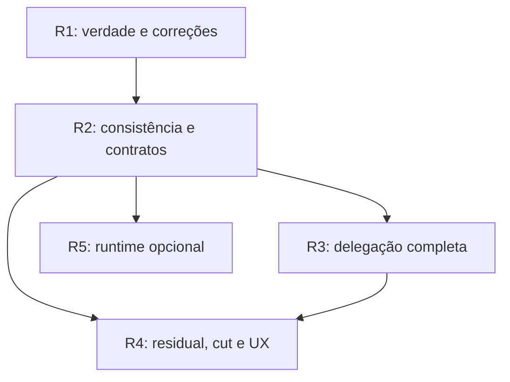

# POSE — frente 10: documentação, backlog consolidado e composição das releases

Data: 2026-10-12. Revisão fonte:
`35ffb4a66817803c4cc42f56e41bf2e667e52da9`, após o merge do PR #155.
Escopo: concluir o programa de dez análises, reconciliar seus candidatos com
trabalho existente e propor entregas verificáveis. A fonte de comportamento
permanece o código; relatos/specs dão intenção, e probes dão evidência delimitada.

Companions: [backlog estruturado](../results/2026-10-12-pose-front-10-consolidated-backlog.json),
[gerador e verificador](../results/2026-10-12-pose-front-10-build-backlog.py) e
[índice das dez frentes](2026-10-11-pose-analysis-index.md).
As propostas não são novas issues adjudicadas, specs iniciadas, políticas
adotadas, manifests preparados ou compromissos de calendário.

## 1. Parecer final e direção de produto

O POSE já tem fundações relevantes para o objetivo do mantenedor: obrigações
projetadas, requests materiais, efeitos por fase, review/evidência governados,
reuso, context tipado, closeout recuperável e adapters nativos. A análise não
recomenda substituí-las nem acrescentar um rito humano obrigatório para cada
operação. Recomenda corrigir a confiança e as fronteiras de execução antes de
ampliar o que o motor afirma e automatiza.

A maior lacuna transversal é um resultado afirmar mais do que foi observado:
assurance lido sem prova, scan perdido como zero, done tratado como verificação,
resultado associado como evidência da spec, snapshot válido como suficiência de
release, status indisponível como clean. A segunda é ausência de uma conclusão
operacional uniforme: timeout, condição ainda pendente, efeito parcial e retry
não têm o mesmo significado em todos os caminhos. Performance e UX devem
consumir essas correções, preservando cobertura e autonomia.

A consolidação tem **96 candidatos de origem, 44 unidades canônicas, seis ondas
propostas e 33 itens históricos reconciliados**. Cada candidato tem exatamente
um owner canônico; sua origem e aceite continuam disponíveis. Consolidar não
apagar requisito: os critérios das fontes são conservados no JSON, além de um
critério decisivo por unidade. As 44 unidades não significam 44 novas specs.
Há continuação de specs abertas, qualificação de implementação existente,
correções sobre bases concluídas e trabalho futuro condicionado.

Priorizar integridade demonstrada e contenção de falsos resultados. Entregar
revisão delegada completa sobre prova e ledger; tratar residual segundo natureza,
compromisso e efeito; tornar o cut verificável; extrair domínio comum e oferecer
runtime opcional por worktree após consistência. Não usar limite global de 100
specs/commits para acelerar gates completos, não promover tudo a blocker e não
chamar um MCP duradouro de motor compartilhado já entregue.

## 2. Método, baseline e limites

O gerador lê as nove análises, seus candidatos estruturados, specs e fundações,
resolve 96 aliases, verifica cobertura única e DAG, confere 61 fontes com hash
na revisão fixa e compara o motor com a tag 7.4.1. O diff de `pose-mcp` é vazio;
as frentes anteriores não corrigiram o motor. Seus defeitos/probes mantêm
relevância, com o nível de evidência original, sem nova alegação de eficácia.

A releitura com o binário oficial 7.4.1 retornou 383 specs: 376 done, cinco draft,
uma in-progress e uma abandoned. Follow-ups: 309 totais, 108 abertos, 11 vencidos
e 42 sem dono. São contagens segundo o leitor atual, cujas lacunas foram
reproduzidas nas frentes 4/5/9. Attention declarou complete true na revisão fonte;
isso é resposta observada, não prova de que os limites de completude já foram
corrigidos. Nenhuma disposition ou adoção foi alterada aqui.

Não somar os 108 resíduos aos 96 candidatos como se fossem 204 features. Os
primeiros são itens existentes de projetos/specs; os segundos descrevem correções
e evoluções do motor e das jornadas. A [frente 5](2026-10-12-pose-front-05-residual-work.md)
propôs classes para os 108: 39 aceitos/adiados, 27 implementação material,
16 adoção/piloto, 13 operação, 12 revisão de evidência e um candidato à satisfação.
São triagem proposta, não 39 riscos formalmente aceitos nem um item fechado.

A suíte Go/race detector não foi reexecutada: Go indisponível. Não houve vendor
run, rollout externo, nova experiência com usuário, reconstrução do motor ou
nova verificação de publicação no provider nesta frente. O check estrutural e a
validação do catálogo conferem esta entrega documental; não encerram os bugs.
Não fabricar duração/esforço, dono individual, prazo ou SemVer definitivo.

## 3. Reconciliar o backlog anterior sem reabrir entregas

Os 33 POSE-01…POSE-33 de 2026-10-03 foram confrontados na frente 1 e novamente
associados às specs atuais. O JSON preserva os 33 nomes, classificação original,
status atual e limite residual. A distribuição continua: 27 implementation-present,
três partial, uma adoção com validação humana pendente, uma adoção registrada e
um inventário sem apply.

Implementation-present não significa eficácia universal: os deltas T2/T4/F07,
por exemplo, mostram defeitos em mecanismos presentes. Também não autoriza
reimplementar actions, Attention ou readiness do zero. Preservar entregas e
cutoffs; abrir correção estreita ligada à fonte quando uma spec done não descreve
o novo delta. Não acrescentar requisitos retrospectivos a uma entrega selada
para transformar sua história em promessa que não fez.

| Recorte anterior | Situação mantida | Destino nesta consolidação |
|---|---|---|
| POSE-01…05, 07…11, 13…26, 28, 31, 32 | Base implementada | Corrigir os deltas documentados, com regressões e compatibilidade |
| POSE-06 | Reconciliação parcialmente operacional | B25: triagem atualizável por evidência e autoridade |
| POSE-12 | Cobertura não universal | B06/B34: perda explícita e identidade de leitura |
| POSE-27 | Observabilidade parcial | B26/B32: condição versus resposta e custo reproduzível |
| POSE-29 | Piloto/adoção registrados; fricção humana ainda não medida | B42: piloto externo e de UX, sem refazer adoção genericamente |
| POSE-30 | Adoção ABM registrada | Preservar decisão e scope; não adotar outra capability automaticamente |
| POSE-33 | Inventário/dry-run, sem apply de migração | B43: trabalho breaking condicionado, fora do próximo cut |

A presença de uma spec done para inventário não prova que migration apply existe.
A mensagem atual de `migrate` fala em 6.x e futura 7.0, embora o motor seja 7.4.1;
a correção de comunicação B28 é distinta da implementação breaking B43.

## 4. Specs abertas e estratégia de reaproveitamento

| Spec atual | Status | Trabalho a continuar | Tratamento antes de iniciar |
|---|---|---|---|
| [Run provenance](../specs/2026-10-09-pose-delegated-review-run-provenance.md) | draft | B17 | Reconciliar R3 com vendor OU modelo diferente; manter machine-attested distinto de pessoa |
| [Attempt ledger](../specs/2026-10-09-pose-delegated-review-attempt-ledger.md) | draft | B16 | Incluir reserva/estado durável, integridade e rejeição; reason não apaga rejeição de bundle inalterado |
| [Delegated capability](../specs/2026-10-09-pose-delegated-review-capability.md) | draft | B19/B21 | Entregar três kinds e engine recording; não declarar completa só com review |
| [Action fulfillment](../specs/2026-10-09-pose-delegated-review-action-fulfillment.md) | draft | B20 | Vínculo à prova e integração local/remota dependem de ledger/provenance/capability |
| [Amendment history](../specs/2026-10-10-pose-amendment-history-holds-before-close.md) | draft | Parcela de B11 | Reproduzir caso existente, baseline append-only e gate antes de close; delta semântico do plan é separado |
| [Update dry-run](../specs/2026-10-09-pose-update-dry-run-reports-the-whole-update.md) | in-progress | B29 | Código/trace já presentes; revalidar cobertura e qualificar fechamento, sem novo subsistema |

O [ADR de delegação](../adr/2026-10-09-delegated-review-is-an-adapter.md) está aceito.
Três drafts ainda dizem “pending acceptance/provisional answers”. Não perguntar
novamente quem aplica ou se vendor diferente é obrigatório: o mantenedor decidiu
que o engine registra run verificado, vendor OU modelo diferente satisfaz
independência, vendor diferente é preferido e pessoas participam por policy e
exceção. O roadmap e o brief/dispatch são entregas parciais a preservar.

Antes de execução, declarar artifacts de implementação na spec continuada,
reconciliar seus requisitos/dependências com o ADR e usar os gates existentes.
Para fundação done, abrir delta pequeno com linkage explícito, sem reescrever
assurance/decisões históricas. Para uma proposta nova de runtime/cut, definir
spec e ADR quando o desenho for adjudicado; este relatório não os substitui.

## 5. Catálogo canônico e aceite

P0 significa prioridade de integridade, não exploração remota demonstrada.
P1 cobre garantia atual violada ou fundação necessária; P2 cobre evolução
operacional e adoção eficaz; P3 é futuro breaking condicionado. O julgamento
de prioridade não altera metadata das specs existentes.

As tabelas abaixo são geradas a partir do mesmo catálogo do JSON. IDs T2/T3/T4,
F05/F06/F07, PERF, CONS e D01…D13 conservam o caminho para o relatório original.
Fonte confirmada e probe reproduzido continuam distintos; uma unidade pode
conter ambos. Dependências exatas e foundations com path/status estão no JSON.

### R1 — Verdade e correções compatíveis

| ID / prioridade | Unidade e aliases de origem | Aceite decisivo |
|---|---|---|
| B01 / P0 | Prova persistida e disclosure coerentes — T2-01, T2-03 | Adulteração de answer/actor/digest/proof não satisfaz condição; JSON/MCP/gate consomem a mesma prova sem promover legado. |
| B02 / P1 | Preflight semântico de aprovação no domínio — T2-02 | Approval inválida grava zero artefatos em Store/CLI/import/MCP; negativa legítima permanece registrável. |
| B04 / P1 | Tempo de confiança e proveniência de reuso — T2-06, T2-07 | Separar validade histórica de autorização atual; clock injetável e fonte do reuso verificada, com ciclos/custo limitados. |
| B05 / P1 | Scopes de policy e efetividade válidos — T2-08 | Typo de scope não se apresenta como proteção efetiva; extensão desconhecida tem diagnóstico/versionamento. |
| B06 / P1 | Leitura completa ou perda explicitada por fonte — T2-05, D01, D13, F05-01, F05-03 | Journal/scan/parser ilegível ou descartado não vira zero completo; paridade de follow-ups e cobertura por recorte. |
| B07 / P1 | Git desconhecido e snapshot de dispatch verificável — D02, T3-02, CONS-03 | Status com erro/assume-unchanged não certifica árvore intacta; paths e inputs selados são verificados antes/depois. |
| B08 / P1 | Restrições por target, fase e identidade de nó — T4-01, T4-04 | Cross-target e roadmap só restringem o destino correto; requests de origem terminal seguem visíveis; kind/ID resolvem exatamente. |
| B09 / P1 | Autoridade de waiver e supersession — T4-02 | Dispensa e substituição não retiram condição de terceiro sem autoridade/prova exigidas; cancellation mantém a semântica própria. |
| B10 / P1 | Recuperação e preflight de requests — T4-03, T4-05, CONS-01 | Retry do mesmo ID completa supersession uma vez; invalidated/missing-subject/decline têm próximo passo suportado; preview verifica admissibilidade sem escrever. |
| B11 / P1 | Fechamento semântico e histórico de amendments — D09, F07-01 | Done/no-op não certifica review ausente; close antecipa gate de amendments e preserva baseline append-only e cutoffs. |
| B12 / P1 | Resultado e parsing comuns CLI/MCP — F07-02, F07-03, F07-09, PERF-07, CONS-13 | Um JSON por chamada; flags/modos inválidos recusados; waiting/deadline/conflict/partial-commit distintos de verdict de domínio. |
| B13 / P1 | Journals, checkpoints e recovery de locks — CONS-02, CONS-07, CONS-12 | EOF/schema/seq integrais; checkpoint corrupt/unavailable não vira absent; owner vivo nunca tem lock quebrado por idade. |
| B28 / P1 | Instruções distribuídas executáveis — D11, F07-06 | Workflow/skill/scaffold/pt-BR usam freshness comum; suggest revela regra ausente; migrate explica apply não disponível sem prometer 7.0 futura. |
| B29 / P1 | Qualificar e reconciliar update dry-run — D10 | Confrontar copy/real update, source discovery, symlink/permissão e trace; código presente não significa novo subsistema nem fechamento automático. |
| B30 / P1 | Facts vinculados à spec e freshness — F07-05 | Check de outro módulo/digest é candidato não vinculado; facts não inventam conclusão semântica; reuso adequado preservado. |
| B38 / P1 | Manifest íntegro e snapshot da tag — F06-04, F06-06 | Schema/projeções redundantes recompostos; manifest/archive/notes/version source no tree da tag; história legítima não é invalidada por próximo ciclo. |
| B44 / P2 | Reconciliar narrativa documental e promessas de releases — reconciliação documental da frente 10 | História 6.x/7.0 preservada como contexto; relatório atual distingue entregue/adoção/eficácia; drafts não reabrem ADR aceito nem anunciam capability ausente. |

### R2 — Consistência e contratos comuns

| ID / prioridade | Unidade e aliases de origem | Aceite decisivo |
|---|---|---|
| B03 / P1 | Presença consistente entre emitters — T2-04 | Policy delimita presença e nenhum canal alternativo a dispensa; matriz SSH/SK/issuer verifica o contrato. |
| B14 / P1 | Publisher exclusivo e coordenação/CAS entre writers — CONS-04, CONS-06, CONS-09 | Sem staging compartilhado ou lost update; curated preservada; efeito antes de erro tem receipt e precondições verificáveis. |
| B15 / P1 | Geração completa dos índices — CONS-05 | Leitor recebe conjunto coerente ou unavailable; falha/crash não certifica mistura de gerações; migração preserva consumers atuais. |
| B16 / P1 | Ledger e reserva durável de tentativas delegadas — D05, T3-01, T3-03 | Cota K inicia no máximo K runs; setup/crash registrados; retry não duplica; rejeição/corrupção não restaura orçamento. |
| B22 / P1 | Cobertura material e IDs de residual/marker — F05-02, F05-04 | Menção a arquivo é associação candidata; ocorrências distintas têm IDs distintos e vínculos sobrevivem rewrap/reordenação. |
| B32 / P2 | Algoritmos por operação e benchmark seguro — D12, PERF-01, PERF-02, PERF-03, PERF-05 | Perfil por produtor; catálogo/bundle/Git reusados; clustering preserva semântica; benchmark isolado preserva verdict e arquivos locais. |
| B34 / P1 | Read views, geração e invalidação de dependências — D03, T4-06, PERF-09, CONS-10 | Answer/subject/policy/tests/index/refs relevantes mudam geração; watcher é hint; interleaving causa retry/unknown, não autorização stale. |
| B36 / P1 | Cursor e consulta ligados à geração — PERF-11 | Mutação entre páginas retorna snapshot consistente ou cursor stale explícito; filtros/ordem vinculados; limit reduz trabalho quando indexável. |
| B37 / P1 | Suficiência compartilhada do cut e critérios tipados — D08, F06-01, F06-02, F06-03 | Plan/apply avaliam mesmo escopo; delivery sem evidência não passa; heading/ref não reconhecido é explicitado; path não é approval. |
| B39 / P1 | Replay temporal da evidência de publicação — F06-05, F06-09, F06-10 | Hashes/identidade/assets/coverage revalidados; candidate stale distinto de história íntegra; open-next só consome resultado validado. |
| B41 / P1 | Prepare/record de release com recovery — CONS-08 | Fases/inventário persistidos; retry evento não duplica; compensação falha preserva material; não fabricar manifest por backfill. |

### R3 — Revisão delegada completa

| ID / prioridade | Unidade e aliases de origem | Aceite decisivo |
|---|---|---|
| B17 / P1 | Run assinado e independência observada — D04, T3-04 | Bundle/prompt/output/executor/config vinculados; vendor OU modelo distinto conforme ADR; machine-attested não é pessoa. |
| B18 / P1 | Isolamento, recursos e retenção do adapter — D06, T3-06 | Worktree não é anunciada como sandbox; recursos/streams/descendentes/retention têm limites e qualificação por plataforma. |
| B19 / P1 | Conclusões governadas de review, adjudication e smoke — T3-05, T3-07 | Conclusão completa validada vai ao destino tipado pelo engine; seeded defect rejeitado; notas não modificam authority/criteria. |
| B20 / P1 | Fulfillment por runner local e remoto — T3-08 | Request satisfeita só por run válido correlacionado; local/CI/Harne8 têm mesmo contrato; pessoa apenas por policy/exceção. |
| B21 / P2 | Adoção e eficácia da delegação completa — T3-09, T3-10 | Opt-in delimitado e rollback; três kinds atravessam jornada; rejeição exige mudança; docs/drafts seguem ADR aceito. |

### R4 — Residual, cut e experiência comprovados

| ID / prioridade | Unidade e aliases de origem | Aceite decisivo |
|---|---|---|
| B23 / P1 | Metadata válida e destino de encaminhamento reconciliado — F05-05, F05-06 | Datas reais; destino abandoned/órfão/superseded/cíclico sinalizado; done não aplica disposition sem adequação. |
| B24 / P2 | Natureza, compromisso e efeito do trabalho residual — D07, F05-07 | Dívida/defeito/incompletude/evidência/adoção/opcional distintos; legado não classificado; categoria não cria gate sozinha. |
| B25 / P2 | Triagem revisável e risco aceito — F05-08, F05-09 | 108 itens reconciliados por diff/autoridade com razão e gatilho; preview/apply idempotentes sem disposition automática. |
| B26 / P2 | Métricas de condição, resposta e trabalho — T4-08, F05-10 | Decline não encerra restrição; intervalos não duplicados; desconhecido não vira zero ou timestamp fabricado. |
| B27 / P2 | Próxima ação proporcional e autorização preservada — T4-07, T4-09, T4-10, F07-07, F07-08 | Holder/executor/pessoa/advisory distintos; autorização vigente reaproveitada; quatro kinds retomam a fase pertinente. |
| B40 / P1 | Seleção de escopo e exclusividade antes do freeze — F06-07, F06-08 | Subconjunto coerente explícito; dupla assignment recusada antes de mover fila; exclusão/adiamento/outcome têm significado próprio. |
| B42 / P2 | Piloto integrado de UX e contratos adversariais — F07-10 | Oito percursos pessoa/agente com baseline/stop-go/rollback; medir trabalho útil/reuso; presença de campo não equivale a eficácia. |

### R5 — Domínio compartilhado e runtime opcional

| ID / prioridade | Unidade e aliases de origem | Aceite decisivo |
|---|---|---|
| B31 / P2 | API comum e handoff CLI/MCP — F07-04, PERF-06 | Mesmos resultados/erros/authority pelo domínio; wrappers deixam de spawnar onde extraídos; stdio de cliente não é IPC compartilhável. |
| B33 / P2 | Vistas de grafo e caches limitados/isolados — PERF-04, PERF-10, CONS-11 | Mutation/race tests profundos; bytes e misses coordenadas limitados; sem cópia/expansão total desnecessária ou contaminação cruzada. |
| B35 / P2 | Runtime opcional por worktree e budgets de concorrência — PERF-08, PERF-12 | Handshake engine/schema/root, start/stop/restart, fallback CI/standalone e QoS testados; RAM/CPU/latência medidos por cenário. |

### R6 — Migração breaking condicionada

| ID / prioridade | Unidade e aliases de origem | Aceite decisivo |
|---|---|---|
| B43 / P3 | Migração breaking somente após benefício e prova — POSE-33; suplemento da frente 10 | Inventário atual por campo; dry-run sem write; apply com guard/recovery; significado/assinatura de história preservados; major não é reforma geral. |


## 6. Releases propostas e critérios de cut

São seis ondas de resultado, não seis manifests criados. Números são sugestões
para planejamento na linha atual, subordinadas ao diff, consumidores e SemVer.
R1 pode ser dividida em patches pequenos; nenhum patch anuncia toda a onda antes
de atendê-la. Evolução aditiva de schema/semântica pública passa a minor, e
incompatibilidade/removal exige migration prospectiva/major quando pertinente.
Não tratar a correção de falso verified ou recusa de registro antes aceito como
compatível por definição.

| Onda | Versão indicativa | Composição | Resultado que permite anunciar | Condição de stop |
|---|---|---|---|---|
| R1 | 7.4.2 se compatível; primeira minor corretiva caso necessário | 17 unidades de verdade, requests, close/output/docs e manifest | Consumidores não afirmam prova/coverage/terminal além do verificado; defeitos reproduzidos têm regressões | Mudança de contrato não versionada, efeito sem autorização, legado convertido retrospectivamente |
| R2 | 7.5.0 candidata | 11 unidades de coordenação/geração, ledger, residual básico, suficiência e replay | Writers/queries têm estado parcial/inconclusivo fiel e reuso preserva inputs; cut básico deixa de certificar evidência inadequada | Lost update, mistura de gerações, ledger perde tentativa/rejeição, compensação apaga material |
| R3 | 7.6.0 candidata | Cinco unidades restantes de delegação, após B16 da R2 | Review, adjudication e smoke completos com prova, destino e fulfillment; engine registra sem aplicação manual genérica | Algum kind depende de bypass/prefixo/manualidade; rejection pode ser descartada; plataforma anunciada sem contenção |
| R4 | 7.7.0 candidata | Sete unidades de taxonomia/triagem/métricas/UX e cut selecionável | Residual e compromisso reconciliados; release seleciona escopo coerente; piloto mede utilidade e fricção | Rótulo cria blocker global, similaridade fecha item, deadline de triagem vira promessa ou piloto fabrica causalidade |
| R5 | 7.8.0 candidata | API comum, vistas/caches e runtime opcional | CLI/MCP reutilizam o domínio, com geração, budgets, handshake e fallback standalone comprovados | RAM sem limite, stale autoriza gate, CI exige daemon, paginação perde cobertura |
| R6 | 8.0.0 só se justificada; não agendada | B43 | Migração real com benefício por campo e recovery preservando história | Não há benefício medido, dry-run fiel, revisão guardada ou rollback verificável |

A ordem não exige esperar toda R4 para melhorar algoritmos: B32 pode avançar em
R2 independentemente de taxonomia. A extração arquitetural R5 pode começar após
suas precondições, enquanto o piloto R4 ocorre. Não tornar runtime a dependência
da correção de leitura ou do review delegado. O cut de cada release deve declarar
seu subconjunto/outcome; se retirar uma unidade, registrar exclusão/adiamento e
recompor dependências, sem continuar anunciando a promessa original completa.



R3 é requisito do piloto integrado completo em R4, não de todo trabalho local
de taxonomia. R6 não é sucessor obrigatório: é uma decisão futura por benefício.

Para cada cut, registrar outcomes, refs/digests selecionados, componentes/canais,
critério de suficiência, resultado de execução, cobertura e risco residual.
Preservar a distinção entre preparado, tagged, published e verified. Um fragmento
válido no snapshot não substitui outcome; tag existente não prova tree correto;
import factual de publicação não é bloqueado para esconder uma operação externa
que já aconteceu. O contrato de release futuro precisa usar essa distinção.

## 7. Documentação: alinhar fontes, história e capacidade atual

| Fonte | Divergência/risco confirmado | Correção proposta e momento |
|---|---|---|
| Roadmaps record-truthfulness/agency-readiness | Títulos e cuts 6.3.x/6.4, membros majoritariamente entregues | B44: declarar época histórica e ligar reconciliação atual; decidir fechamento por gate/outcome, não renomear 6.4 para 7.5 |
| Governance-efficiency/epistemic-lifecycle | Programas draft descrevem trabalho presente e limitações diferentes | Separar delivered foundation, adoção e piloto pendente; não apagar registro de programa |
| Onboarding/consolidation v7 | Narrativa de cut 7.0 não serve como promessa da próxima release | Preservar o plano histórico e indicar evolução atual; validar jornada antes de claim |
| Drafts de delegated-review | Referem aceitação pendente apesar de ADR aceito | B21/B44: reconciliar texto e dependências sem reabrir decisões do mantenedor |
| Workflows/skills/scaffold/pt-BR | Instruções ainda podem mandar repetir assessment fora da freshness entregue | B28: regressões sobre arquivos distribuídos, alias e disponibilidade real de regra/extension |
| Manual de obligations/Attention | Pode sugerir coverage íntegra enquanto probes mostram perda/scopes errados | Atualizar junto de B06/B08/B34; explicar query success versus cobertura e autorização |
| CLI migrate/dry-run | Mensagem em 6.x promete apply em futura 7.0 | B28 descreve limitação atual; B43 só anuncia apply quando implementado |
| Benchmark de governança | Ignore exit codes/restaura `.pose/indexes` e state com checkout | B32 usa checkout descartável, retém verdict/ambiente e nunca descarta trabalho do operador |
| Docs de review/release/runtime | Risco de anunciar envelope como approval, run como review completa, ledger como suficiência ou MCP como cache comum | Vincular claims ao resultado do consumidor e à versão publicada; roadmap fica separado da documentação operacional |

Esta entrega cria a fonte atual de reconciliação e atualiza o índice; não substitui
massivamente históricos, drafts ou manuais por instruções de capacidades futuras.
Corrigir documentação operacional em cada PR de comportamento, com exemplos
executáveis, paths válidos e corpus de instalação/upgrade. Atualização editorial
sem adoção é diferente de mudar policy; nenhum relatório autoriza verified,
require_presence, delegated-review ou daemon obrigatório na instância.

## 8. Verificação por resultado e rollout

| Família | Prova mínima | Limite que deve continuar visível |
|---|---|---|
| Confiança | Adulteração pós-write, sem prova, emitter/presence/time, approval zero-write e reuso | Assinatura não certifica adequação intelectual ou presença humana universal |
| Requests/readiness | Cross-target, roadmap, origem terminal, waiver, supersession parcial, decline/missing subject e retry | Resposta não é satisfação universal; escopo disjunto não é independência provada |
| Residual | Scanner longo/ilegível, IDs repetidos, mention-only, datas, destino abandonado/cíclico | Candidato de reconciliação não aplica disposition |
| Close e superfície | Done sem review, amendment history, JSON/modos/flags, context e CLI/MCP | No-op não é verificação; paridade não reduz assurance do transporte |
| Releases | Manifest/schema/projeções/tag tree/assets, duplicates assignment, partial prepare e scope subset | Histórico íntegro e candidato stale são diferentes; snapshot não prova publicação |
| Consistência | Interleavings, Write/Sync/Link/Rename failures, history/checkpoint, kill por fase, restart | Probe Linux não qualifica power loss, Windows ou filesystem de rede |
| Delegação | Reserva K, tentativa interrompida, ledger íntegro, seeded defect, três destinos, fulfillment local/remoto | Completed process não é approval; worktree não é sandbox |
| Performance/runtime | Corpus congelado em escalas, CPU/heap/bytes/startup, hot versus cold process, generation mutation | Três amostras não dão p95; pagination não deve cortar histórico de gate |
| UX/adoption | Oito percursos pessoa/agente, trabalho útil/reusado, causa de stop/rework e stop/go | Dogfooding/CI não medem automaticamente fricção humana ou eficácia externa |

Executar testes de domínio e consumidor, gates do módulo, corpus de legado,
instalação/upgrade e jornadas CLI/MCP quando disponíveis. Abranger recusa,
unknown e efeito parcial, não só happy path. Tornar a baseline explícita e
comparar verdict/cobertura antes de tempo ou número de comandos.

Rollout de mudanças de enforcement é prospectivo e delimitado por capability/
policy. Pilotar em standalone e num runner/control plane representativo, mantendo
fall back. Harne8 atual não foi inspecionado nesta frente; referências externas
existentes são intenção/registro histórico. Não inferir que integração do consumer
está pronta pela implementação no POSE. Aceite de R3 inclui caminho local/CI e
contrato de Harne8 sem tornar essa plataforma dependência exclusiva do core.

Não adotar os knobs de proteção universalmente para melhorar um número; medir
se o operador conclui trabalho correto com menos busca, retrabalho e pedidos
redundantes. Autorizações suficientes permanecem válidas enquanto inputs materiais
não mudam. Novas perguntas devem ter efeito concreto, opções e responsável por
policy. Não transformar cada decisão arquitetural do backlog em ActionRequest
cosmética nem emitir um quality score agregado.

## 9. Como transformar a proposta em execução

Escolher primeiro uma unidade corrigível e sua foundation; anexar expected versus
observed, fixtures da frente correspondente e dependências. Confirmar quais
requisitos já estão atendidos antes de iniciar código. Declarar artifacts e
aplicar o workflow/gates existentes; corrigir somente o delta. Manter uma unidade
owner para cada alias, com PRs pequenos possíveis dentro de um mesmo outcome.

Na implementação, substituir a situação proposta por evidência de entregue,
adoção e eficácia em campos distintos. Registrar explicitamente o que foi adiado
e por quê. Não fechar uma unidade apenas porque a spec herdada está done ou
porque um review run retornou exit 0. Se dividir uma unidade para revisão,
preservar seus critérios de release e cross-reference, evitando duas fontes de
verdade para o mesmo fato.

Sem estimativa artificial: a sequência é baseada em dependências e risco, não
em semanas ou story points inventados. O owner no JSON é função proposta
maintainer/domain-owner; executor e disponibilidade são definidos ao iniciar a
spec, sem atribuir pessoas externas ou enviar mensagens. Este PR não cria
issues, milestones GitHub, releases, policy decisions ou applies de triagem.

## 10. Reprodução e validação da consolidação

```sh
python3 .pose/results/2026-10-12-pose-front-10-build-backlog.py \
  --output /tmp/pose-consolidated-backlog.json
```

O gerador exige as fontes na revisão fixa. Em implementação futura, não mudar
silenciosamente o significado deste snapshot histórico: criar próxima revisão
da consolidação quando o motor/specs mudarem. Ele verifica os 96 owners únicos,
44 IDs, DAG e compatibilidade de ordem entre waves, caminhos/status das foundations,
61 hashes e ausência de diff do motor ante 7.4.1. O JSON publicado acrescenta
observações da releitura e validação desta entrega; esses metadados não são
novos critérios do produto.

Validação concluída: `POSE_USAGE_SUPPRESS_CLI=1 POSE_CHECK_WORKERS=8 pose check
--strict` terminou com exit 0, SUCCESS e os mesmos 30 avisos existentes. A saída
integral está no JSON. A reconstrução do catálogo foi idêntica antes dos
metadados de observação/validação; 96 owners únicos, 44 linhas do catálogo,
33 itens históricos, DAG/ordem de waves, 61 hashes, syntax Python e links locais
foram conferidos. `git diff --check` passou.

As dez análises estão produzidas e vinculadas no índice. O trabalho de diagnóstico
e proposta está concluído; correção de motor, adoção por instância e eficácia
continuam dependentes das implementações/pilotos descritos. Go/race detector
permanecem não executados neste ambiente.
